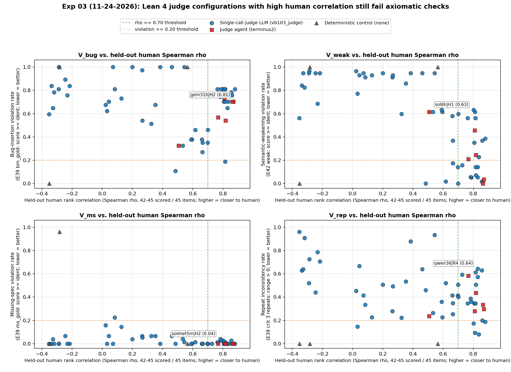
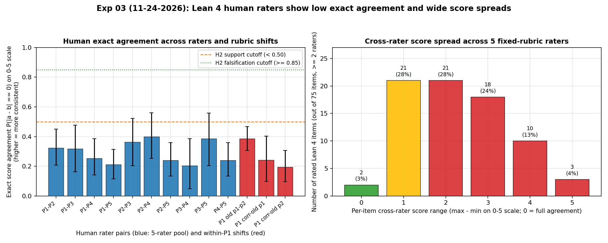

# Results: 03_human_corr_vs_axiomatic_properties_cert_judge (as of 11-24-2026)

Date: `11-24-2026`. **Preregistration:** [PREREG.md](PREREG.md) (committed at [`b571a7d`](https://github.com/brando90/correlation-is-not-trust/commit/b571a7d7ef8872d3ba1a53ed4d02e5746dbcd934) before any run; dated Amendments added `11-24-2026` post-Light QA and post-Mega QA Stage 3).
**Alignment sanity check:** **PASS** — `240/240` recomputed `E42` metrics (`weakening`, `vacuity`, `overconstraint`, `formatting`) match `cert-judge` `semantic_screen.json` within `max_abs_diff = 1.11e-16` (`<= 1e-9` gate). Zero new model calls (`$0.00`).

## Takeaway

- **H1 is SUPPORTED (`22 / 22` high-correlation judge configurations fail, including `22 / 22` even when excluding `V_bug`):** Out of `56` real judge configurations (`50` single-call `vb103_judge` judge LLMs and `6` `terminus2` judge agents) evaluated on VeriBench Lean 4 theorem formalizations, **`22` reach `heldout` Spearman `rho >= 0.70` against the `3`-expert `target_expert` panel (`0.700` to `0.880`, `n = 42–45` scored of `45` declared items across `15` tasks, coverage `>= 0.90`; distinct from Part B's `5`-rater participant pool)**, and **every single one (`22/22`) violates at least one preregistered axiomatic property (`>= 0.20` with lower 95% task-cluster CI `> 0.05`)**. Qualifying `V_bug`: `bm_gold` mutates executable `def` implementations while the human-mirror rubrics score theorem-statement coverage (and Lean compilation alone does not guarantee every mutation alters specification coverage), yet **all `22/22` high-correlation configurations (`0` bug-only triggers) still fail theorem-statement weakening (`V_weak`), repeat inconsistency (`V_rep`), or both**. Across all `56` real judge configurations (conditional/exploratory check ignoring shared models, prompts, and tasks), `rho_heldout` fails to establish a statistically significant monotonic association with `V_bug` (`Spearman = -0.164 [-0.379, +0.076]`, two-sided permutation `p-val = 0.2322`, `n = 56`), while correlating negatively with `V_weak` (`-0.747 [-0.837, -0.612]`, `p-val = 0.0002`) and `V_fmt` (`-0.728 [-0.817, -0.594]`, `p-val = 0.0002`).
- **H2 (cross-rater disagreement & rubric/strictness sensitivity) is SUPPORTED on the exact same Lean 4 domain:** Across `5` fixed-rubric human raters scoring `75` candidate–gold pairs (`25` tasks, `0–5` scale), mean pairwise exact score agreement (`|a - b| == 0`) is only **`0.294 [0.237, 0.353]`** (`< 0.50` gate; `70.6% [64.7%, 76.3%]` disagree by `>= 1` point, `30.7% [22.5%, 38.7%]` by `>= 2` points, mean pairwise Spearman `0.413 [0.152, 0.625]`), and **`69.3% [54.7%, 84.0%]`** (`52/75`) of items have a cross-rater range `>= 2` points (`>= 0.50` gate; `75.0% [56.8%, 91.1%]` on the `44` complete 5-rater items). Within the same annotator (`P1`), a deliberate strictness/re-read shift yields exact agreement **`0.387 [0.307, 0.467]`** (`Spearman = 0.280 [-0.041, 0.551]`), and rubric-wording shifts yield **`0.242 [0.098, 0.403]`** and **`0.194 [0.097, 0.306]`** (these establish cross-rater disagreement and rubric/strictness sensitivity without isolating same-person, same-rubric test-retest instability).

---

## Part A (H1): High-human-correlation judge configurations still fail axiomatic checks

Table 1 lists all `22` real judge configurations with `heldout` Spearman `rho >= 0.70` against the `3`-expert `target_expert` panel (`coverage >= 0.90`; `n = 42` for `sonnet5m|D0`, `qwen36|D0`, `t2_qwen|D0`, `t2_sonnet5|D0` and `n = 45` for the remaining `18`, out of `45` declared across `15` tasks), sorted descending by `rho_heldout`. The `Model` column shows declared benchmark selectors (`model_declared`); in source metadata (`results/summary.json`), `gem31h` served as `google/gemini-3.1-pro-preview` (declared `google/gemini-3.1-pro-preview-high`) and `qwen36`/`t2_qwen` served as `alibaba/qwen3.6-27b` (declared `alibaba/qwen3.6-27b-thinking`), while all other models match `model_declared == model_served` (selector differences alone do not establish different underlying weights). All intervals are 95% percentile task-cluster bootstrap intervals (`2,000` draws for property rates, seed `20261124`; `10,000` draws from `E39` for `rho_heldout`; `p-val=n/a` per configuration). Violation rates are lower-is-better on `[0, 1]`.

| Config | Harness | Model | `n` | `rho_heldout` [95% CI] | `V_bug` [95% CI] | `V_ms` [95% CI] | `V_weak` [95% CI] | `V_vac` [95% CI] | `V_overc` [95% CI] | `V_fmt` (gap) [95% CI] | `V_rep` [95% CI] | H1 triggers |
|---|---|---|---|---|---|---|---|---|---|---|---|---|
| `gem31h\|H2` | `vb103_judge` (judge LLM) | `google/gemini-3.1-pro-preview-high` | 45 | **0.880** [0.697, 0.947] | **0.811** [0.625, 0.951] | 0.000 [0.000, 0.000] | **0.386** [0.246, 0.544] | 0.000 [0.000, 0.000] | 0.054 [0.000, 0.135] | 0.000 (0.000) [0.000, 0.000] | 0.187 [0.107, 0.280] | `V_bug`, `V_weak` |
| `t2_qwen\|H2` | `terminus2` (judge agent) | `alibaba/qwen3.6-27b-thinking` | 45 | **0.870** [0.677, 0.942] | **0.703** [0.455, 0.914] | 0.000 [0.000, 0.000] | 0.035 [0.000, 0.088] | 0.000 [0.000, 0.000] | 0.027 [0.000, 0.083] | 0.000 (0.000) [0.000, 0.000] | **0.297** [0.194, 0.413] | `V_bug`, `V_rep` |
| `t2_sonnet5\|H2` | `terminus2` (judge agent) | `anthropic/claude-sonnet-5-medium` | 45 | **0.864** [0.664, 0.939] | **0.703** [0.455, 0.914] | 0.000 [0.000, 0.000] | 0.000 [0.000, 0.000] | 0.000 [0.000, 0.000] | 0.000 [0.000, 0.000] | 0.000 (0.000) [0.000, 0.000] | **0.333** [0.213, 0.440] | `V_bug`, `V_rep` |
| `gem31h\|H1` | `vb103_judge` (judge LLM) | `google/gemini-3.1-pro-preview-high` | 45 | **0.860** [0.623, 0.944] | **0.757** [0.555, 0.927] | 0.000 [0.000, 0.000] | **0.368** [0.228, 0.526] | 0.000 [0.000, 0.000] | 0.027 [0.000, 0.083] | 0.000 (0.000) [0.000, 0.000] | **0.200** [0.107, 0.293] | `V_bug`, `V_weak`, `V_rep` |
| `qwen36\|H1` | `vb103_judge` (judge LLM) | `alibaba/qwen3.6-27b-thinking` | 45 | **0.857** [0.654, 0.931] | **0.784** [0.568, 0.951] | 0.027 [0.000, 0.067] | 0.018 [0.000, 0.053] | 0.000 [0.000, 0.000] | 0.189 [0.079, 0.334] | 0.000 (0.000) [0.000, 0.000] | **0.630** [0.500, 0.753] | `V_bug`, `V_rep` |
| `opus55x\|H2` | `vb103_judge` (judge LLM) | `anthropic/claude-opus-5-5-no-fallback` | 45 | **0.837** [0.591, 0.939] | **0.703** [0.455, 0.914] | 0.000 [0.000, 0.000] | **0.228** [0.140, 0.316] | 0.000 [0.000, 0.000] | 0.000 [0.000, 0.000] | 0.000 (0.000) [0.000, 0.000] | 0.080 [0.027, 0.147] | `V_bug`, `V_weak` |
| `qwen36\|R4` | `vb103_judge` (judge LLM) | `alibaba/qwen3.6-27b-thinking` | 45 | **0.830** [0.559, 0.927] | **0.649** [0.378, 0.878] | 0.000 [0.000, 0.000] | 0.140 [0.053, 0.228] | 0.000 [0.000, 0.000] | 0.027 [0.000, 0.083] | 0.000 (0.000) [0.000, 0.000] | **0.644** [0.493, 0.787] | `V_bug`, `V_rep` |
| `qwen36\|H0` | `vb103_judge` (judge LLM) | `alibaba/qwen3.6-27b-thinking` | 45 | **0.829** [0.549, 0.929] | **0.757** [0.576, 0.909] | 0.000 [0.000, 0.000] | 0.053 [0.000, 0.105] | 0.000 [0.000, 0.000] | 0.000 [0.000, 0.000] | 0.000 (0.000) [0.000, 0.000] | **0.573** [0.440, 0.720] | `V_bug`, `V_rep` |
| `t2_qwen\|D0` | `terminus2` (judge agent) | `alibaba/qwen3.6-27b-thinking` | 42 | **0.818** [0.528, 0.942] | **0.541** [0.293, 0.757] | 0.000 [0.000, 0.000] | **0.246** [0.175, 0.316] | 0.000 [0.000, 0.000] | 0.000 [0.000, 0.000] | 0.000 (0.000) [0.000, 0.000] | **0.437** [0.310, 0.569] | `V_bug`, `V_weak`, `V_rep` |
| `qwen36\|H2` | `vb103_judge` (judge LLM) | `alibaba/qwen3.6-27b-thinking` | 45 | **0.817** [0.569, 0.919] | **0.703** [0.455, 0.914] | 0.000 [0.000, 0.000] | 0.071 [0.018, 0.143] | 0.000 [0.000, 0.000] | 0.056 [0.000, 0.139] | 0.000 (0.000) [0.000, 0.000] | **0.507** [0.370, 0.640] | `V_bug`, `V_rep` |
| `sonnet5m\|D0` | `vb103_judge` (judge LLM) | `anthropic/claude-sonnet-5-medium` | 42 | **0.815** [0.441, 0.948] | 0.189 [0.070, 0.317] | 0.000 [0.000, 0.000] | 0.140 [0.070, 0.211] | 0.000 [0.000, 0.000] | 0.000 [0.000, 0.000] | 0.000 (0.000) [0.000, 0.000] | **0.611** [0.446, 0.775] | `V_rep` |
| `luna6h\|H2` | `vb103_judge` (judge LLM) | `openai/gpt-6-luna-high` | 45 | **0.815** [0.553, 0.929] | **0.811** [0.579, 1.000] | 0.013 [0.000, 0.041] | **0.561** [0.368, 0.737] | 0.000 [0.000, 0.000] | 0.405 [0.289, 0.514] | 0.000 (0.000) [0.000, 0.000] | **0.347** [0.213, 0.480] | `V_bug`, `V_weak`, `V_rep` |
| `sol6h\|H2` | `vb103_judge` (judge LLM) | `openai/gpt-6-sol-high` | 45 | **0.811** [0.467, 0.932] | **0.811** [0.579, 1.000] | 0.000 [0.000, 0.000] | **0.614** [0.421, 0.807] | 0.000 [0.000, 0.000] | 0.514 [0.351, 0.676] | 0.000 (0.000) [0.000, 0.000] | 0.093 [0.027, 0.173] | `V_bug`, `V_weak` |
| `t2_luna\|H2` | `terminus2` (judge agent) | `openai/gpt-6-luna-high` | 45 | **0.810** [0.563, 0.928] | **0.730** [0.465, 0.951] | 0.000 [0.000, 0.000] | **0.456** [0.298, 0.614] | 0.000 [0.000, 0.000] | 0.432 [0.297, 0.559] | 0.000 (0.000) [0.000, 0.000] | **0.280** [0.160, 0.427] | `V_bug`, `V_weak`, `V_rep` |
| `gem31h\|R4` | `vb103_judge` (judge LLM) | `google/gemini-3.1-pro-preview-high` | 45 | **0.807** [0.480, 0.931] | **0.703** [0.439, 0.927] | 0.000 [0.000, 0.000] | **0.351** [0.211, 0.492] | 0.000 [0.000, 0.000] | 0.324 [0.194, 0.447] | 0.000 (0.000) [0.000, 0.000] | **0.347** [0.266, 0.440] | `V_bug`, `V_weak`, `V_rep` |
| `sol6h\|H1` | `vb103_judge` (judge LLM) | `openai/gpt-6-sol-high` | 45 | **0.802** [0.464, 0.938] | **0.811** [0.579, 1.000] | 0.026 [0.000, 0.074] | **0.632** [0.439, 0.825] | 0.000 [0.000, 0.000] | 0.514 [0.351, 0.676] | 0.000 (0.000) [0.000, 0.000] | 0.173 [0.093, 0.253] | `V_bug`, `V_weak` |
| `sonnet5m\|H1` | `vb103_judge` (judge LLM) | `anthropic/claude-sonnet-5-medium` | 45 | **0.788** [0.592, 0.867] | **0.811** [0.594, 1.000] | 0.026 [0.000, 0.064] | 0.053 [0.000, 0.140] | 0.000 [0.000, 0.000] | 0.054 [0.000, 0.135] | 0.000 (0.000) [0.000, 0.000] | **0.360** [0.253, 0.467] | `V_bug`, `V_rep` |
| `sonnet5m\|H2` | `vb103_judge` (judge LLM) | `anthropic/claude-sonnet-5-medium` | 45 | **0.783** [0.518, 0.909] | **0.743** [0.545, 0.917] | 0.041 [0.000, 0.091] | 0.055 [0.000, 0.123] | 0.000 [0.000, 0.000] | 0.027 [0.000, 0.083] | 0.000 (0.000) [0.000, 0.000] | **0.387** [0.280, 0.507] | `V_bug`, `V_rep` |
| `t2_sonnet5\|D0` | `terminus2` (judge agent) | `anthropic/claude-sonnet-5-medium` | 42 | **0.768** [0.389, 0.929] | **0.568** [0.303, 0.818] | 0.000 [0.000, 0.000] | **0.211** [0.140, 0.281] | 0.000 [0.000, 0.000] | 0.000 [0.000, 0.000] | 0.000 (0.000) [0.000, 0.000] | **0.583** [0.423, 0.743] | `V_bug`, `V_weak`, `V_rep` |
| `luna6h\|H1` | `vb103_judge` (judge LLM) | `openai/gpt-6-luna-high` | 45 | **0.763** [0.463, 0.915] | **0.811** [0.579, 1.000] | 0.013 [0.000, 0.041] | **0.561** [0.368, 0.737] | 0.000 [0.000, 0.000] | 0.405 [0.289, 0.514] | 0.000 (0.000) [0.000, 0.000] | **0.347** [0.213, 0.493] | `V_bug`, `V_weak`, `V_rep` |
| `qwen36\|D0` | `vb103_judge` (judge LLM) | `alibaba/qwen3.6-27b-thinking` | 42 | **0.727** [0.438, 0.895] | **0.757** [0.533, 0.947] | 0.000 [0.000, 0.000] | 0.158 [0.088, 0.228] | 0.000 [0.000, 0.000] | 0.000 [0.000, 0.000] | 0.000 (0.000) [0.000, 0.000] | **0.592** [0.426, 0.761] | `V_bug`, `V_rep` |
| `luna6h\|H0` | `vb103_judge` (judge LLM) | `openai/gpt-6-luna-high` | 45 | **0.700** [0.246, 0.899] | **0.459** [0.211, 0.727] | 0.000 [0.000, 0.000] | **0.596** [0.404, 0.772] | 0.000 [0.000, 0.000] | 0.514 [0.351, 0.676] | 0.000 (0.000) [0.000, 0.000] | **0.400** [0.267, 0.547] | `V_bug`, `V_weak`, `V_rep` |

Key structural notes across all `60` units (full table with exact per-configuration 95% CIs in [results/judge_table.csv](results/judge_table.csv)):
- **`V_bug` ties and qualification:** Across all `22` high-correlation judge configurations (`17` judge LLMs and `5` judge agents), `strict_gt = 0.000` (every `V_bug` violation is a tie `score(buggy) == score(ident)`). Because `bm_gold` mutates executable `def` bodies while `H0`/`H1`/`H2`/`R4`/`D0` grade theorem-statement coverage — and Lean compilation alone does not establish that an implementation edit alters specification coverage — `V_bug` alone is insufficient to establish rubric failure. Crucially, `0` configurations rely solely on `V_bug`: **`22/22` still violate `V_weak`, `V_rep`, or both**. Across all `56` real judge configurations, strict bug violations (`score(buggy) > score(ident)`) reached up to `0.568` on lower-correlation prompts.
- **Formatting and vacuity pass on top judge configurations (`0.000`), while repeat variance & renaming gaps remain:** All `22` high-correlation judge configurations achieve `V_fmt = 0.000` (`fmt_mean_gap = 0.000`), `V_vac = 0.000`, and `V_blank <= 0.083`. Yet `18/22` fail `V_rep >= 0.20` (and `12/22` fail `V_weak >= 0.20`, all `12` also clearing `ci_lo > 0.05`), and on the descriptive `n <= 3` Lean-valid binder-renaming probe (`V_alpha_desc`, `n=2..3`), `10/22` changed score on at least `1` renamed item (`qwen36|H2` changed on `2/2`, `t2_qwen|H2` and `t2_luna|H2` changed on `1/3`). `E39 reorder` had `0/75` valid probes (`NOT_COMPUTABLE`).
- **Deterministic controls (`harness = none`):** `ctl|count_ratio` reaches `rho_heldout = 0.565 [0.071, 0.854]` (`n = 45/45`) despite `1.000 [1.000, 1.000]` violation rate on `V_bug`, `V_weak`, `V_vac`, and `V_overc`. `ctl|editdist` scores `-0.352 [-0.740, 0.279]` (`n = 45/45`, `V_fmt = 1.000 [1.000, 1.000]`), `ctl|random` scores `-0.283 [-0.511, -0.006]` (`n = 45/45`, `V_ms = 0.961 [0.903, 1.000]`), and `ctl|name_jaccard` has `100%` coverage (`45/45`) with `rho_heldout` undefined (`None`) because its criterion scores are constant across those `45` items.

### Table 2: Descriptive family means by harness/model and conditional cross-judge Spearman with `rho_heldout` (`n = 56` real judge configurations)

Family rows below are unweighted descriptive averages over `n` prompt configurations (`p-val=n/a`); individual per-configuration 95% CIs are in Table 1 and [results/judge_table.csv](results/judge_table.csv). Cross-judge correlations in the bottom row treat the `56` configurations as exchangeable despite shared models, prompts, and tasks and are therefore **conditional/exploratory** (`2,000`-draw unit bootstrap 95% CI, `5,000`-draw two-sided permutation `p-val`, seed `20261124`).

| Group / Statistic | Harness | Model (`n` configs) | `rho_heldout` | `V_bug` | `V_ms` | `V_weak` | `V_vac` | `V_fmt` | `V_rep` |
|---|---|---|---|---|---|---|---|---|---|
| `t2_qwen` mean | `terminus2` (judge agent) | `alibaba/qwen3.6-27b-thinking` (2) | 0.844 | 0.622 | 0.000 | 0.140 | 0.000 | 0.000 | 0.367 |
| `t2_sonnet5` mean | `terminus2` (judge agent) | `anthropic/claude-sonnet-5-medium` (2) | 0.816 | 0.635 | 0.000 | 0.105 | 0.000 | 0.000 | 0.458 |
| `t2_luna` mean | `terminus2` (judge agent) | `openai/gpt-6-luna-high` (2) | 0.659 | 0.527 | 0.047 | 0.535 | 0.000 | 0.105 | 0.258 |
| `qwen36` mean | `vb103_judge` (judge LLM) | `alibaba/qwen3.6-27b-thinking` (9) | 0.574 | 0.850 | 0.012 | 0.472 | 0.000 | 0.003 | 0.680 |
| `sonnet5m` mean | `vb103_judge` (judge LLM) | `anthropic/claude-sonnet-5-medium` (9) | 0.477 | 0.599 | 0.057 | 0.415 | 0.009 | 0.120 | 0.403 |
| `gem31h` mean | `vb103_judge` (judge LLM) | `google/gemini-3.1-pro-preview-high` (9) | 0.457 | 0.799 | 0.012 | 0.585 | 0.015 | 0.041 | 0.369 |
| `opus55x` mean | `vb103_judge` (judge LLM) | `anthropic/claude-opus-5-5-no-fallback` (5) | 0.360 | 0.508 | 0.013 | 0.404 | 0.005 | 0.158 | 0.449 |
| `luna6h` mean | `vb103_judge` (judge LLM) | `openai/gpt-6-luna-high` (9) | 0.320 | 0.622 | 0.018 | 0.729 | 0.000 | 0.099 | 0.502 |
| `sol6h` mean | `vb103_judge` (judge LLM) | `openai/gpt-6-sol-high` (9) | 0.251 | 0.652 | 0.035 | 0.723 | 0.000 | 0.117 | 0.383 |
| **Spearman with `rho_heldout`** [95% CI], `p-val` | `56` real configs | all `vb103_judge` + `terminus2` (`56`) | 1.000 | **-0.164** [-0.379, +0.076], `p=0.2322` | **-0.296** [-0.514, -0.051], `p=0.0250` | **-0.747** [-0.837, -0.612], `p=0.0002` | **-0.317** [-0.479, -0.154], `p=0.0112` | **-0.728** [-0.817, -0.594], `p=0.0002` | **-0.392** [-0.620, -0.133], `p=0.0032` |

(Additional conditional/exploratory `n = 56` Spearman correlations with `rho_heldout`: `V_overc = -0.551 [-0.687, -0.367], p=0.0002`; `fmt_mean_gap = -0.708 [-0.791, -0.579], p=0.0002`; `V_blank = -0.377 [-0.554, -0.183], p=0.0044`.)

---

## Part B (H2): Cross-rater disagreement and rubric sensitivity on the exact same Lean 4 domain

### Table 3: Human inter-rater reliability, cross-rater item spread, LORO, and within-human rubric shifts (`0–5` scale)

All intervals in Table 3 are 95% percentile task-cluster bootstrap intervals (`2,000` draws over each comparison's observed tasks, seed `20261124`; `p-val=n/a`).

| Comparison / Slice | Items (`n`), Tasks | Spearman `rho` [95% CI] | Exact Agree `\|a-b\|==0` [95% CI] | Disagree `>= 1` [95% CI] | Disagree `>= 2` [95% CI] | MAD / MAE / Range [95% CI] | Notes |
|---|---|---|---|---|---|---|---|
| **5-rater pool mean across 10 pairs** (`P1_correct`, `P2..P5`) | `44–75` per pair, `15–25` tasks | **0.413** [0.152, 0.625] | **0.294** [0.237, 0.353] | **0.706** [0.647, 0.763] | **0.307** [0.225, 0.387] | MAD **1.172** [0.985, 1.359] | H2 supported (`ci_hi = 0.353 < 0.50`) |
| Highest exact-agree pair (`P2` vs `P4`) | `75`, `25` | 0.550 [0.207, 0.769] | 0.400 [0.253, 0.560] | 0.600 [0.440, 0.747] | 0.467 [0.307, 0.640] | MAD 1.387 [0.920, 1.853] | `>= 2`-pt gap on `46.7%` despite top exact agree |
| Highest-`rho` pair (`P1_correct` vs `P2`) | `71`, `24` | 0.867 [0.752, 0.927] | 0.324 [0.208, 0.451] | 0.676 [0.549, 0.792] | 0.042 [0.000, 0.097] | MAD 0.718 [0.577, 0.859] | High rank order yet only `32.4%` exact agree |
| Weakest pair (`P3` vs `P4`) | `44`, `15` | 0.053 [-0.624, 0.584] | 0.205 [0.049, 0.386] | 0.795 [0.614, 0.951] | 0.523 [0.325, 0.733] | MAD 1.727 [1.182, 2.273] | `>= 2`-pt gap on `52.3%` |
| **Per-item spread (`>= 2` raters)** | `75`, `25` | `n/a` | Unanimous (`range=0`): **0.027** [0.000, 0.067] | `range>=1`: **0.973** [0.933, 1.000] | `range>=2`: **0.693** [0.547, 0.840] | Mean range **2.293** [1.920, 2.680] | `range>=3`: **0.413** [0.267, 0.560]; `SD=0.907` [0.774, 1.043] |
| Sensitivity: complete 5-rater items | `44`, `15` | `n/a` | Unanimous: **0.000** [0.000, 0.000] | `range>=1`: **1.000** [1.000, 1.000] | `range>=2`: **0.750** [0.568, 0.911] | Mean range **2.432** [1.978, 2.889] | `range>=3`: **0.500** [0.310, 0.689]; `SD=0.939` [0.779, 1.105] |
| Sensitivity: 4 full raters (`P1_correct,P2,P4,P5`) | `71`, `24` | `n/a` | Unanimous: **0.056** [0.000, 0.127] | `range>=1`: **0.944** [0.873, 1.000] | `range>=2`: **0.676** [0.514, 0.817] | Mean range **2.225** [1.789, 2.662] | `range>=3`: **0.380** [0.236, 0.530]; `SD=0.899` [0.733, 1.066] |
| **Leave-one-rater-out (LORO) mean** | `44–75` per rater, `15–25` tasks | **0.572** [0.360, 0.724] | `n/a` | `n/a` | `n/a` | MAE **1.010** [0.865, 1.158] | `P2` best (`0.821 [0.657, 0.900]`), `P5` lowest (`0.294 [-0.018, 0.570]`) |
| **Within-human: `P1_old_pass1` vs `P1_old_pass2`** | `75`, `25` | **0.280** [-0.041, 0.551] | **0.387** [0.307, 0.467] | **0.613** [0.533, 0.693] | **0.147** [0.067, 0.227] | MAD **0.773** [0.627, 0.920] | Signed shift `-0.293 [-0.547, -0.013]` |
| **Within-human: `P1_correct` vs `P1_old_pass1`** | `62`, `21` | **0.165** [-0.158, 0.494] | **0.242** [0.098, 0.403] | **0.758** [0.597, 0.902] | **0.597** [0.426, 0.770] | MAD **1.629** [1.193, 2.081] | Signed diff `+1.242 [+0.603, +1.871]` |
| **Within-human: `P1_correct` vs `P1_old_pass2`** | `62`, `21` | **0.076** [-0.260, 0.402] | **0.194** [0.097, 0.306] | **0.806** [0.694, 0.903] | **0.419** [0.242, 0.603] | MAD **1.355** [1.032, 1.689] | Signed diff `+0.774 [+0.206, +1.344]` |

Note on sample overlap in Part B: `P1_correct` has `74/75` scored rows; `1` task (`3` items) had a renamed task key relative to `P2–P5` (`n = 71` matched pairs), and `4` tasks (`12` items) had pre-renumbering task keys relative to `old_prompt` (`n = 62` exact-key pairs). All calculations used exact non-imputed observed matches only.

---

## Limitations & scope
1. **Prior-exposure reanalysis:** All `cert-judge` E39/E42 harvests and `human_labels` TSVs pre-existed; fresh zero-exposure evaluation remains planned.
2. **`V_bug` construct boundary:** `bm_gold` mutates executable `def` bodies while `H0`–`H2`/`R4`/`D0` evaluate theorem-statement coverage; Lean elaboration alone does not verify behavioral divergence. Even setting `V_bug` aside, `22/22` high-correlation judge configurations fail `V_weak` or `V_rep`.
3. **Sparse/missing probes in `E39`:** `alpha` (binder renaming) had only `n = 3` Lean-elaborating candidates and `reorder` had `0/75`; robust renaming/permutation tests require a fresh benchmark design.
4. **`pass@k` and `boxed accuracy`:** Not applicable to Lean 4 theorem-specification adequacy here; evaluated in math/code experiments (`02` and planned prospective runs).
5. **H2 human-inconsistency scope & `target_expert` vs. 5-rater pool:** Part A's `rho_heldout` evaluates against the `3`-expert `target_expert` panel (differing from `target_all5` on `41/45` held-out items), whereas Part B measures cross-rater disagreement across the `5` fixed-rubric participant raters (`P1_correct`, `P2`–`P5`) and within-`P1` deliberate strictness (`A->B`) and rubric-wording (`C->D`) shifts (rather than pure same-person, same-rubric test-retest instability).
6. **Public privacy constraint:** Raw human TSV rows, annotator names, and Lean code files remain off-repo in `/Users/brandomiranda/cert-judge/`.
