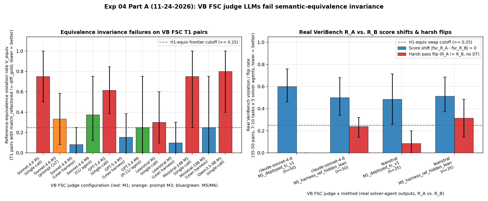
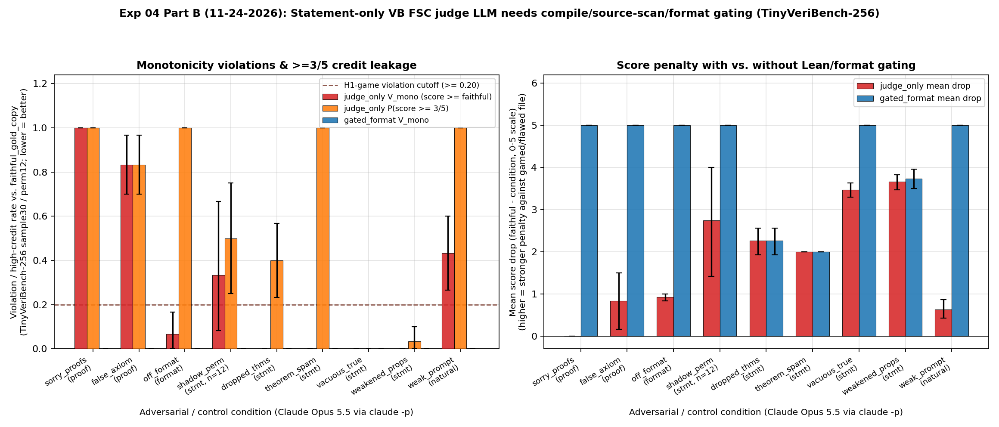

# Results: 04_vb_fsc_equivalence_invariance_and_gaming_violations (11-24-2026)

Date: `11-24-2026` (reanalysis of cached VeriBench Formal Specification Coverage [`FSC`] outputs; `$0.00` new model calls; preregistered before any run in [PREREG.md](PREREG.md) with dated Amendments on `11-24-2026`).

## Takeaway

- **Overall verdict — `H1-equiv = SUPPORTED`, `H1-game = SUPPORTED`:** Deployed single-call VeriBench `FSC` judge LLMs fail semantic equivalence invariance, and the standalone human-rubric statement-coverage judge LLM (`claude-opus-5-5` `judge_only`) leaves both expected statement-only rubric blind spots on proof-level attacks and a verified statement-shadowing/format vulnerability until Lean compilation, kernel axiom auditing, and structural format checks are added. Together with Experiment `03` (direct `3`-expert human-correlation counterexample), these results support **Idea 1** on VeriBench `FSC`.
- **Semantic equivalence failures are large (`V_equiv` `0.615–0.750`, real VeriBench `V_ref_swap` `0.486–0.600`), while exact variable renaming (`V_rename_exact`) and dual-reference order (`V_order`) are mostly `0.000`:** Under the deployed `M1_deployed_tc_v1` prompt, `claude-sonnet-4-6` (`claude-p-cli`) changes scores across Lean-kernel-proved equivalent `T1` targets (`match_refactored` vs. `diff_gold`) on **`0.750 [0.500, 1.000]`** (`n = 12` tasks, anchoring gap `A_G = 0.417 [0.242, 0.592]`, `p = 0.003906`) and across swapped real VeriBench references (`R_A` vs. `R_B`, `n = 50` solver-agent–task pairs across `10` tasks) on **`0.600 [0.460, 0.760]`**. `gpt-5.4` (`openai-api`, uniform `effort=low`) under `M1_deployed_tc_v1` shows **`V_equiv = 0.615 [0.385, 0.846]`** (`n = 13`, `A_G = 0.300 [0.123, 0.492]`, `p = 0.007998`) and repeat inconsistency **`V_rep_ab = 0.400 [0.200, 0.500]`** (`n = 10` items). Exact renaming (`V_rename_exact`) is `0.000 [0.000, 0.000]` on every tested config except `ministral-8b-2512` (`mistral-api`) under `M3_prompt_nonexcl_cot` (`0.333 [0.000, 1.000]`, `n = 3`), and `M4_dual_ref` has `V_order = 0.000 [0.000, 0.000]` across all `5` tested judge LLMs while still leaking **`0.517–0.817`** false credit (`fc`) on `T0` inadequate specs.
- **Reference-isolated harnesses (`M5`, `M6`) curb synthetic equivalence shift and repeat variance (including same-effort sensitivity), while real VeriBench reference swaps still flip ~50% of pairs:** `M5_harness_ref_hidden_lean` cuts synthetic `V_equiv` to `0.083 [0.000, 0.250]` (`claude-p-cli`, `claude-sonnet-4-6`), `0.154 [0.000, 0.385]` (`openai-api`, `gpt-5.4`, `effort = mixed (low/medium)`, `V_rep_ab = 0.000 [0.000, 0.000]`; restricting `gpt-5.4::M5` to the `12/13` same-effort pairs lowers `V_equiv` further to **`0.083 [0.000, 0.250]`**), and `0.100 [0.000, 0.300]` (`mistral-api`, `labs-leanstral-1-5-1`). Note that `gpt-5.4` `M2`–`M5` contain mixed `low`/`medium` efforts whereas `M1` is `low`, so cross-method comparisons partially conflate effort changes. On real VeriBench `exp_c`, `M5` shrinks `mean_abs_fsc_shift` (e.g., `0.192 [0.116, 0.280]` to `0.074 [0.038, 0.116]` for `claude-sonnet-4-6`), yet `V_ref_swap` stays **`0.500 [0.340, 0.680]`** (`claude-sonnet-4-6`) and **`0.514 [0.371, 0.686]`** (`labs-leanstral-1-5-1`), and strict binary pass flip rates rise (`0.240 [0.140, 0.320]` vs. `0.000 [0.000, 0.000]`).
- **Proof validity, statement-shadowing failures, and bounded `theorem_spam` under `claude-opus-5-5` (`claude -p --tools ''`, `0–5` rubric; `low` effort on `TinyVeriBench-256`, `max` on `VB256`):** Proof-only attacks (`sorry_proofs` `V_mono = 1.000 [1.000, 1.000]` on `TinyVeriBench-256` `n = 30` and `VB256` `n = 30`, `0.667 [0.417, 0.917]` on `perm12` `n = 12`; `false_axiom_proofs` `0.833 [0.700, 0.967]`, `0.667 [0.417, 0.917]`, `0.800 [0.633, 0.933]`) are outside a statement-only coverage rubric and confirm expected rubric behavior — establishing that **a standalone coverage judge LLM cannot safely score benchmarks without Lean compilation/kernel gates**. Independently of proof validity, statement-level `shadowed_perm_sorted_pairwise` yields **`V_mono = 0.333 [0.083, 0.667]`** (`0.500 [0.250, 0.750]` scoring `>= 3/5`) under both `judge_only` and compile/source-scan `gated`, while `off_format_missing_sections` retains `4.067 [4.000, 4.167]` under both; compile/kernel/format gating eliminates all observed proof-gaming, `shadowed_perm_sorted_pairwise`, and `off_format_missing_sections` violations (`0.000 [0.000, 0.000]` on tested samples). By contrast, `theorem_spam` retains every gold theorem obligation and appends trivial proved theorems: because the source rubric caps the dominating-spam penalty at `2` points (`mean = 3.000 [3.000, 3.000]` to `3.250 [3.000, 3.500]`, `V_mono = 0.000 [0.000, 0.000]`, `100% >= 3/5`), its `100%` gate passage and `>= 3/5` scores reflect expected gate and rubric behavior rather than gate evasion (`dropped_most_theorems` scores `2.733 [2.432, 3.067]`, `0.400 [0.233, 0.567]` `>= 3/5`).
- **Joint Idea 1 status across Experiments 03 & 04:** Experiment 03 serves as the direct human-correlation counterexample (`22/22` qualifying Lean 4 judge configurations — `17` judge LLMs and `5` judge agents — with held-out `target_expert` Spearman `rho_heldout >= 0.70` still fail axiomatic weak-monotonicity, repeat, or bug checks); Experiment 04 establishes on VeriBench `FSC` itself that deployed frontier judge LLMs fail semantic equivalence invariance and that standalone human-rubric `judge_only` evaluation fails without compilation, kernel-audit, and structural gates (plus leaves `shadowed_perm_sorted_pairwise` gaps under compile/source-scan gating alone). Direct per-judge human VB `FSC` correlation remains a separate empirical link to measure alongside these exact `M1`–`M6` / `judge_only` runs.

All 95% confidence intervals use `2,000`-draw task-cluster percentile bootstrap resampling (`seed = 20261124`).

---

## Reproducibility & Alignment Checks

| Check | Scope | Checks run | Max abs diff | Tolerance | Result |
|---|---|---:|---:|---:|---|
| Alignment A (`judge-reference-anchoring` Exp 01) | `exp_ab` (`cm`, `cd`, `A_G`, `fc` incl. `M2` `blind`) + `exp_c` (`mean_abs_fsc_shift`) | 86 | `1.11e-16` | `<= 1e-9` | Passed (`86/86`) |
| Alignment B (`trustworthy-theorem-judges` Exp 23) | `tiny256_sample30` (`mean`, `mean_drop`, `11 x 3` rows) | 66 | `0.003333` | `<= 0.0051` | Passed (`66/66`) |

Unit/artifact tests (`python3 -m unittest experiments/04_vb_fsc_equivalence_invariance_and_gaming_violations/scripts/test_analysis.py -v`): `4/4` passed (`OK`).

---

## Part A: Reference-Equivalence, Renaming, Order & False Credit (`exp_ab` + `exp_b`)

`V_equiv` is the fraction of paired `T1` tasks with `|fsc_norm(match_refactored) - fsc_norm(diff_gold)| > 1e-12`; `A_G` is `mean(match_refactored - diff_gold)` with two-sided paired sign-flip `p-val`. `V_rename_exact` compares `match_exact` vs. `match_refactored`. `V_order` compares `dual_ab` vs. `dual_ba` under `M4_dual_ref`. `fc` is mean `fsc_norm` on provably inadequate `T0` specs (`non_covering`, or `blind` under `M2`). `V_rep_ab` is the repeat-inconsistency share across `(task, condition)` items with `>= 2` repeats. Additional summary columns (`cm`, `cd`, `harsh_flip_ge9`, `harsh_flip_eq10`, `fc_harsh_ge9`, `rep_mean_range`) are reported in the full 31-row table: [equiv_invariance_table.csv](results/equiv_invariance_table.csv).

### Frontier Single-Call Judge LLMs vs. Harnesses & CLI Judge Agents

| Config (`judge_id::method`) | Harness | Model (effort) | `n` (`T1`) | `V_equiv` [95% CI] | `A_G` [95% CI], `p` | `V_rename_exact` (`n`) | `V_order` (`n`) | `fc` on `T0` [95% CI] (`n`) | `V_rep_ab` (`n`) |
|---|---|---|---:|---|---|---|---|---|---|
| `claude-sonnet-4-6::M1_deployed_tc_v1` | `claude-p-cli` | `claude-sonnet-4-6` (default) | 12 | **`0.750 [0.500, 1.000]`** | `0.417 [0.242, 0.592]`, `0.0039` | `0.000 [0.000, 0.000]` (6) | `n/a` | `0.675 [0.475, 0.887]` (8) | `n/a` |
| `gpt-5.4::M1_deployed_tc_v1` | `openai-api` | `gpt-5.4` (low) | 13 | **`0.615 [0.385, 0.846]`** | `0.300 [0.123, 0.492]`, `0.0080` | `0.000 [0.000, 0.000]` (13) | `n/a` | `0.650 [0.383, 0.917]` (6) | `0.400 [0.200, 0.500]` (10) |
| `claude-sonnet-4-6::M2_blind_no_ref` | `claude-p-cli` | `claude-sonnet-4-6` (default) | 12 (blind) | `n/a` (`blind_t1 = 0.850 [0.775, 0.900]`) | `n/a` | `n/a` | `n/a` | `0.425 [0.288, 0.562]` (8) | `n/a` |
| `gpt-5.4::M2_blind_no_ref` | `openai-api` | `gpt-5.4` (`mixed (low/medium)`) | 13 (blind) | `n/a` (`blind_t1 = 0.877 [0.762, 0.962]`) | `n/a` | `n/a` | `n/a` | `0.433 [0.200, 0.683]` (6) | `n/a` |
| `claude-sonnet-4-6::M3_prompt_nonexcl_cot` | `claude-p-cli` | `claude-sonnet-4-6` (default) | 12 | `0.333 [0.083, 0.583]` | `0.050 [0.008, 0.100]`, `0.1250` | `0.000 [0.000, 0.000]` (6) | `n/a` | `0.588 [0.350, 0.825]` (8) | `n/a` |
| `gpt-5.4::M3_prompt_nonexcl_cot` | `openai-api` | `gpt-5.4` (`mixed (low/medium)`) | 13 | `0.000 [0.000, 0.000]` | `0.000 [0.000, 0.000]`, `1.0000` | `0.000 [0.000, 0.000]` (13) | `n/a` | `0.733 [0.467, 1.000]` (6) | `n/a` |
| `claude-sonnet-4-6::M4_dual_ref` | `claude-p-cli` | `claude-sonnet-4-6` (default) | 6 (dual) | `n/a` | `n/a` | `n/a` | `0.000 [0.000, 0.000]` (6) | `0.688 [0.400, 0.900]` (8) | `n/a` |
| `gpt-5.4::M4_dual_ref` | `openai-api` | `gpt-5.4` (`mixed (low/medium)`) | 13 (dual) | `n/a` | `n/a` | `n/a` | `0.000 [0.000, 0.000]` (13) | `0.817 [0.550, 1.000]` (6) | `n/a` |
| `claude-sonnet-4-6::M5_harness_ref_hidden_lean` | `claude-p-cli` | `claude-sonnet-4-6` (default) | 12 | `0.083 [0.000, 0.250]` | `0.058 [0.000, 0.175]`, `1.0000` | `n/a` | `n/a` | `0.538 [0.275, 0.787]` (8) | `n/a` |
| `gpt-5.4::M5_harness_ref_hidden_lean` | `openai-api` | `gpt-5.4` (`mixed (low/medium)`) | 13 | `0.154 [0.000, 0.385]` | `-0.023 [-0.138, 0.069]`, `1.0000` | `n/a` | `n/a` | `0.583 [0.283, 0.867]` (6) | `0.000 [0.000, 0.000]` (7) |
| `claude-sonnet-4-6-agent::M6_harness_cli_agent` | `claude-code-cli` | `claude-sonnet-4-6` (default) | 8 | `0.375 [0.125, 0.750]` | `0.112 [0.012, 0.287]`, `0.2500` | `n/a` | `n/a` | `0.350 [0.150, 0.650]` (4) | `n/a` |
| `pi-frontier-gpt54::M6_harness_cli_agent` | `pi-cli` | `koyejolab-openai-bm/gpt-5.4` (low) | 4 | `0.250 [0.000, 0.750]` | `0.025 [0.000, 0.075]`, `1.0000` | `n/a` | `n/a` | `0.200 [0.000, 0.400]` (2) | `n/a` |

*Same-effort sensitivity (`gpt-5.4` `M3` and `M5`):* `4/13` pairs under `gpt-5.4::M3_prompt_nonexcl_cot` and `1/13` pair (`easy_set__12_mystringlength`, `0.7` vs. `0.4`) under `gpt-5.4::M5_harness_ref_hidden_lean` have differing recorded efforts (`match_refactored` at `medium` vs. `diff_gold` at `low`). Restricting to uniform-effort pairs gives `V_equiv_same_effort = 0.000 [0.000, 0.000]` (`n = 9`, `A_G = 0.000`) for `gpt-5.4::M3` and **`0.083 [0.000, 0.250]`** (`1/12`, `A_G = -0.050 [-0.150, 0.000]`) for `gpt-5.4::M5` (full sensitivity columns in [equiv_invariance_table.csv](results/equiv_invariance_table.csv); primary `M1` is uniformly `low`).

### Open-Weight Judge LLMs & CLI Judge Agents

| Config (`judge_id::method`) | Harness | Model (effort/mode) | `n` (`T1`) | `V_equiv` [95% CI] | `A_G` [95% CI], `p` | `V_rename_exact` (`n`) | `V_order` (`n`) | `fc` on `T0` [95% CI] (`n`) | `V_rep_ab` (`n`) |
|---|---|---|---:|---|---|---|---|---|---|
| `leanstral::M1_deployed_tc_v1` | `mistral-api` | `labs-leanstral-1-5-1` (thinking-on) | 10 | `0.300 [0.098, 0.600]` | `0.160 [0.039, 0.330]`, `0.2500` | `0.000 [0.000, 0.000]` (6) | `n/a` | `0.350 [0.183, 0.600]` (6) | `0.500 [0.333, 0.667]` (10) |
| `ministral-14b::M1_deployed_tc_v1` | `mistral-api` | `ministral-14b-2512` (`temp=0.0`) | 4 | `0.750 [0.250, 1.000]` | `0.325 [0.125, 0.500]`, `0.2500` | `n/a` | `n/a` | `0.500 [0.500, 0.500]` (2) | `n/a` |
| `ministral-8b::M1_deployed_tc_v1` | `mistral-api` | `ministral-8b-2512` (`temp=0.0`) | 4 | `0.500 [0.000, 1.000]` | `0.250 [0.000, 0.500]`, `0.5000` | `0.000 [0.000, 0.000]` (3) | `n/a` | `0.250 [0.000, 0.500]` (4) | `n/a` |
| `qwen3.5-9b::M1_deployed_tc_v1` | `ollama-local` | `qwen3.5:9b-q4_K_M` (`think_off`) | 5 | `0.800 [0.400, 1.000]` | `0.640 [0.320, 0.800]`, `0.1250` | `0.000 [0.000, 0.000]` (2) | `n/a` | `0.750 [0.500, 1.000]` (4) | `n/a` |
| `leanstral::M2_blind_no_ref` | `mistral-api` | `labs-leanstral-1-5-1` (thinking-on) | 10 (blind) | `n/a` (`blind_t1 = 0.840 [0.690, 0.960]`) | `n/a` | `n/a` | `n/a` | `0.450 [0.333, 0.583]` (6) | `n/a` |
| `ministral-8b::M2_blind_no_ref` | `mistral-api` | `ministral-8b-2512` (`temp=0.0`) | 4 (blind) | `n/a` (`blind_t1 = 0.600 [0.400, 0.700]`) | `n/a` | `n/a` | `n/a` | `0.275 [0.050, 0.550]` (4) | `n/a` |
| `qwen3.5-9b::M2_blind_no_ref` | `ollama-local` | `qwen3.5:9b-q4_K_M` (`think_off`) | 4 (blind) | `n/a` (`blind_t1 = 0.725 [0.375, 0.900]`) | `n/a` | `n/a` | `n/a` | `0.475 [0.200, 0.750]` (4) | `n/a` |
| `leanstral::M3_prompt_nonexcl_cot` | `mistral-api` | `labs-leanstral-1-5-1` (thinking-on) | 10 | `0.100 [0.000, 0.300]` | `0.080 [0.000, 0.240]`, `1.0000` | `0.000 [0.000, 0.000]` (6) | `n/a` | `0.517 [0.233, 0.800]` (6) | `n/a` |
| `ministral-14b::M3_prompt_nonexcl_cot` | `mistral-api` | `ministral-14b-2512` (`temp=0.0`) | 4 | `0.250 [0.000, 0.750]` | `0.025 [0.000, 0.075]`, `1.0000` | `n/a` | `n/a` | `0.750 [0.700, 0.800]` (2) | `n/a` |
| `ministral-8b::M3_prompt_nonexcl_cot` | `mistral-api` | `ministral-8b-2512` (`temp=0.0`) | 4 | `0.500 [0.000, 1.000]` | `0.275 [0.000, 0.600]`, `0.5000` | `0.333 [0.000, 1.000]` (3) | `n/a` | `0.475 [0.000, 0.950]` (4) | `n/a` |
| `qwen3.5-9b::M3_prompt_nonexcl_cot` | `ollama-local` | `qwen3.5:9b-q4_K_M` (`think_off`) | 4 | `0.000 [0.000, 0.000]` | `0.000 [0.000, 0.000]`, `1.0000` | `0.000 [0.000, 0.000]` (2) | `n/a` | `1.000 [1.000, 1.000]` (4) | `n/a` |
| `leanstral::M4_dual_ref` | `mistral-api` | `labs-leanstral-1-5-1` (thinking-on) | 6 (dual) | `n/a` | `n/a` | `n/a` | `0.000 [0.000, 0.000]` (6) | `0.517 [0.233, 0.800]` (6) | `n/a` |
| `ministral-8b::M4_dual_ref` | `mistral-api` | `ministral-8b-2512` (`temp=0.0`) | 3 (dual) | `n/a` | `n/a` | `n/a` | `0.000 [0.000, 0.000]` (3) | `0.550 [0.325, 0.700]` (4) | `n/a` |
| `qwen3.5-9b::M4_dual_ref` | `ollama-local` | `qwen3.5:9b-q4_K_M` (`think_off`) | 2 (dual) | `n/a` | `n/a` | `n/a` | `0.000 [0.000, 0.000]` (2) | `0.800 [0.650, 0.950]` (4) | `n/a` |
| `leanstral::M5_harness_ref_hidden_lean` | `mistral-api` | `labs-leanstral-1-5-1` (thinking-on) | 10 | `0.100 [0.000, 0.300]` | `0.080 [0.000, 0.240]`, `1.0000` | `n/a` | `n/a` | `0.450 [0.200, 0.733]` (6) | `0.200 [0.000, 0.500]` (10) |
| `ministral-14b::M5_harness_ref_hidden_lean` | `mistral-api` | `ministral-14b-2512` (`temp=0.0`) | 4 | `0.250 [0.000, 0.750]` | `-0.050 [-0.150, 0.000]`, `1.0000` | `n/a` | `n/a` | `0.600 [0.200, 1.000]` (2) | `n/a` |
| `ministral-8b::M5_harness_ref_hidden_lean` | `mistral-api` | `ministral-8b-2512` (`temp=0.0`) | 4 | `0.750 [0.250, 1.000]` | `-0.050 [-0.600, 0.550]`, `1.0000` | `n/a` | `n/a` | `0.350 [0.200, 0.650]` (4) | `n/a` |
| `qwen3.5-9b::M5_harness_ref_hidden_lean` | `ollama-local` | `qwen3.5:9b-q4_K_M` (`think_off`) | 4 | `0.250 [0.000, 0.750]` | `0.150 [0.000, 0.450]`, `1.0000` | `n/a` | `n/a` | `1.000 [1.000, 1.000]` (4) | `n/a` |
| `pi-open-ministral::M6_harness_cli_agent` | `pi-cli` | `unassigned-mistral-main/ministral-14b-2512` (default) | 4 | `0.500 [0.000, 1.000]` | `-0.050 [-0.225, 0.075]`, `1.0000` | `n/a` | `n/a` | `0.000 [0.000, 0.000]` (2) | `n/a` |

---

## Part A2: Real VeriBench Reference-Swap Impact (`exp_c`)

Real solver-agent outputs across `5` VeriBench solver agents (`astra`, `claude_code`, `codex`, `fable51`, `pi_open_ministral` in `exp_c_veribench_impact_per_task.csv`, complete 5-solver-agent tasks per [PREREG.md](PREREG.md) Amendment; `M4_dual_ref` has `0` `R_A`/`R_B` pairs because it scores `fsc_Dual`). Full table: [exp_c_ref_swap_table.csv](results/exp_c_ref_swap_table.csv).

| Config (`judge_id::method`) | Harness | Model | Pairs / Tasks | `V_ref_swap` [95% CI] | `mean_abs_fsc_shift` [95% CI] | `signed_shift` (`R_A - R_B`), `p` | `harsh_flip_nodt_eq1` [95% CI] | `harsh_flip_nodt_ge09` [95% CI] | `harsh_flip_dt_eq1` [95% CI] |
|---|---|---|---:|---|---|---|---|---|---|
| `claude-sonnet-4-6::M1_deployed_tc_v1` | `claude-p-cli` | `claude-sonnet-4-6` | 50 / 10 | **`0.600 [0.460, 0.760]`** | `0.192 [0.116, 0.280]` | `0.172 [0.088, 0.266]`, `0.0059` | `0.000 [0.000, 0.000]` | `0.040 [0.000, 0.100]` | `0.000 [0.000, 0.000]` |
| `claude-sonnet-4-6::M5_harness_ref_hidden_lean` | `claude-p-cli` | `claude-sonnet-4-6` | 50 / 10 | `0.500 [0.340, 0.680]` | `0.074 [0.038, 0.116]` | `0.034 [-0.012, 0.084]`, `0.2930` | `0.240 [0.140, 0.320]` | `0.120 [0.020, 0.240]` | `0.220 [0.120, 0.320]` |
| `leanstral::M1_deployed_tc_v1` | `mistral-api` | `labs-leanstral-1-5-1` | 35 / 7 (`all_valid`: 38, `0.447 [0.222, 0.684]`) | `0.486 [0.257, 0.714]` | `0.269 [0.109, 0.451]` | `0.120 [-0.031, 0.312]`, `0.4375` | `0.086 [0.000, 0.200]` | `0.086 [0.000, 0.200]` | `0.086 [0.000, 0.200]` |
| `leanstral::M5_harness_ref_hidden_lean` | `mistral-api` | `labs-leanstral-1-5-1` | 35 / 7 (`all_valid`: 37, `0.514 [0.375, 0.676]`) | `0.514 [0.371, 0.686]` | `0.166 [0.077, 0.257]` | `-0.029 [-0.146, 0.071]`, `0.7500` | `0.314 [0.143, 0.486]` | `0.286 [0.114, 0.457]` | `0.286 [0.143, 0.429]` |
| `claude-sonnet-4-6::M4_dual_ref` | `claude-p-cli` | `claude-sonnet-4-6` | 0 / 0 (`fsc_Dual`) | `n/a` | `n/a` | `n/a` | `n/a` | `n/a` | `n/a` |

---

## Part B: Adversarial Gaming & Monotonicity (`Exp 23`)

All Part B scores come from judge LLM `claude-opus-5-5` via `claude -p --tools ''` (`0–5` human statement-coverage rubric, `judge_only`; run at `low` reasoning effort on `TinyVeriBench-256` [`tiny256_sample30`, `tiny256_perm_sorted_pairwise`] and `max` effort on `VB256` [`vb256_sample30`] per source session metadata), paired against the same-task `faithful_gold_copy` baseline (`mean = 5.000 [5.000, 5.000]` on every dataset). On `TinyVeriBench-256`, `gated` applies a **compile/source-scan gate** (`passes_gate`) and `gated_format` adds rubric structure checks (`passes_gate_and_format`); on `VB256`, `gated_kernel` adds a **kernel-audit gate** (`collectAxioms`, `passes_gate_kernel`) and `full_pipeline` applies all checks (`passes_all_checks`). `V_mono` is `P(score(condition) >= score(faithful))`; `high_credit_ge3` is `P(score >= 3.0)`; `p` is the two-sided exact binomial sign test on non-zero differences. Full 66-row CSV: [gaming_monotonicity_table.csv](results/gaming_monotonicity_table.csv).

### Proof-Level & Structural Gaming Where `judge_only` vs. Gating Diverge

| Dataset (`n`) | Condition (`category`) | `judge_only`: pass, `mean [95% CI]`, `V_mono [95% CI]`, `ge3 [95% CI]` | Compile / Kernel-audit gate (`gated` [Tiny] / `gated_kernel` [VB256]): pass, `mean [95% CI]`, `V_mono [95% CI]`, `ge3 [95% CI]` | Full gate (`gated_format` / `full_pipeline`): pass, `mean [95% CI]`, `V_mono [95% CI]`, `ge3 [95% CI]` | Sign-test `p` (`judge_only` -> full) |
|---|---|---|---:|---|---|
| `tiny256_sample30` (30) | `sorry_proofs` (`proof_gaming`) | `30/30`, `5.000 [5.000, 5.000]`, **`1.000 [1.000, 1.000]`**, `1.000 [1.000, 1.000]` | `0/30`, `0.000 [0.000, 0.000]`, `0.000 [0.000, 0.000]`, `0.000 [0.000, 0.000]` | `0/30`, `0.000 [0.000, 0.000]`, `0.000 [0.000, 0.000]`, `0.000 [0.000, 0.000]` | `1.000` -> `1.86e-09` |
| `tiny256_sample30` (30) | `false_axiom_proofs` (`proof_gaming`) | `30/30`, `4.167 [3.500, 4.833]`, **`0.833 [0.700, 0.967]`**, `0.833 [0.700, 0.967]` | `0/30`, `0.000 [0.000, 0.000]`, `0.000 [0.000, 0.000]`, `0.000 [0.000, 0.000]` | `0/30`, `0.000 [0.000, 0.000]`, `0.000 [0.000, 0.000]`, `0.000 [0.000, 0.000]` | `0.0625` -> `1.86e-09` |
| `tiny256_sample30` (30) | `off_format_missing_sections` (`statement_gaming`) | `30/30`, `4.067 [4.000, 4.167]`, `0.067 [0.000, 0.167]`, **`1.000 [1.000, 1.000]`** | `30/30`, `4.067 [4.000, 4.167]`, `0.067 [0.000, 0.167]`, `1.000 [1.000, 1.000]` | `0/30`, `0.000 [0.000, 0.000]`, `0.000 [0.000, 0.000]`, `0.000 [0.000, 0.000]` | `7.45e-09` -> `1.86e-09` |
| `tiny256_perm_sorted_pairwise` (12) | `sorry_proofs` (`proof_gaming`) | `12/12`, `4.583 [4.167, 4.917]`, **`0.667 [0.417, 0.917]`**, `1.000 [1.000, 1.000]` | `0/12`, `0.000 [0.000, 0.000]`, `0.000 [0.000, 0.000]`, `0.000 [0.000, 0.000]` | `0/12`, `0.000 [0.000, 0.000]`, `0.000 [0.000, 0.000]`, `0.000 [0.000, 0.000]` | `0.1250` -> `0.000488` |
| `tiny256_perm_sorted_pairwise` (12) | `false_axiom_proofs` (`proof_gaming`) | `12/12`, `4.250 [3.250, 4.917]`, **`0.667 [0.417, 0.917]`**, `0.917 [0.750, 1.000]` | `0/12`, `0.000 [0.000, 0.000]`, `0.000 [0.000, 0.000]`, `0.000 [0.000, 0.000]` | `0/12`, `0.000 [0.000, 0.000]`, `0.000 [0.000, 0.000]`, `0.000 [0.000, 0.000]` | `0.1250` -> `0.000488` |
| `tiny256_perm_sorted_pairwise` (12) | `shadowed_perm_sorted_pairwise` (`statement_gaming`) | `12/12`, `2.250 [1.000, 3.585]`, **`0.333 [0.083, 0.667]`**, `0.500 [0.250, 0.750]` | `6/12`, `2.250 [1.000, 3.585]`, `0.333 [0.083, 0.667]`, `0.500 [0.250, 0.750]` | `0/12`, `0.000 [0.000, 0.000]`, `0.000 [0.000, 0.000]`, `0.000 [0.000, 0.000]` | `0.00781` -> `0.000488` |
| `vb256_sample30` (30) | `sorry_proofs` (`proof_gaming`) | `30/30`, `5.000 [5.000, 5.000]`, **`1.000 [1.000, 1.000]`**, `1.000 [1.000, 1.000]` | `0/30`, `0.000 [0.000, 0.000]`, `0.000 [0.000, 0.000]`, `0.000 [0.000, 0.000]` | `0/30`, `0.000 [0.000, 0.000]`, `0.000 [0.000, 0.000]`, `0.000 [0.000, 0.000]` | `1.000` -> `1.86e-09` |
| `vb256_sample30` (30) | `false_axiom_proofs` (`proof_gaming`) | `30/30`, `4.000 [3.167, 4.667]`, **`0.800 [0.633, 0.933]`**, `0.800 [0.633, 0.933]` | `0/30`, `0.000 [0.000, 0.000]`, `0.000 [0.000, 0.000]`, `0.000 [0.000, 0.000]` | `0/30`, `0.000 [0.000, 0.000]`, `0.000 [0.000, 0.000]`, `0.000 [0.000, 0.000]` | `0.03125` -> `1.86e-09` |

*Mechanism note:* On `shadowed_perm_sorted_pairwise` (`6/12` compile/source-scan gate pass) and `shadowed_names` (`13/30` pass), `gated` has the exact same `mean` as `judge_only` (`2.250` and `0.133`) because all gate-failing tasks already scored `0.0` under `judge_only`, while the `6` gate-passing `shadowed_perm_sorted_pairwise` tasks scored `[4.0, 3.0, 5.0, 5.0, 5.0, 5.0]` and were caught `12/12` only by `gated_format`.

### Remaining Gaming, Baseline & Natural Controls (`tiny256_sample30`, `tiny256_perm_sorted_pairwise`, `vb256_sample30`)

| Dataset (`n`) | Condition (`category`) | `judge_only`: `mean [95% CI]`, `V_mono [95% CI]`, `ge3 [95% CI]` | Compile / Kernel-audit gate (`gated` / `gated_kernel`): pass, `mean [95% CI]`, `V_mono [95% CI]`, `ge3 [95% CI]` | Full gate (`gated_format` / `full_pipeline`): pass, `mean [95% CI]`, `V_mono [95% CI]`, `ge3 [95% CI]` | Note |
|---|---|---|---:|---:|---|
| `tiny256_sample30` (30) | `theorem_spam` (`statement_gaming`) | `3.000 [3.000, 3.000]`, `0.000 [0.000, 0.000]`, **`1.000 [1.000, 1.000]`** | `30/30`, `3.000 [3.000, 3.000]`, `0.000 [0.000, 0.000]`, **`1.000 [1.000, 1.000]`** | `30/30`, `3.000 [3.000, 3.000]`, `0.000 [0.000, 0.000]`, **`1.000 [1.000, 1.000]`** | Gold covered; rubric caps spam penalty `<= 2` (`100% >= 3/5`) |
| `tiny256_perm_sorted_pairwise` (12) | `theorem_spam` (`statement_gaming`) | `3.250 [3.000, 3.500]`, `0.000 [0.000, 0.000]`, **`1.000 [1.000, 1.000]`** | `12/12`, `3.250 [3.000, 3.500]`, `0.000 [0.000, 0.000]`, **`1.000 [1.000, 1.000]`** | `12/12`, `3.250 [3.000, 3.500]`, `0.000 [0.000, 0.000]`, **`1.000 [1.000, 1.000]`** | Gold covered; rubric caps spam penalty `<= 2` (`100% >= 3/5`) |
| `vb256_sample30` (30) | `theorem_spam` (`statement_gaming`) | `3.000 [3.000, 3.000]`, `0.000 [0.000, 0.000]`, **`1.000 [1.000, 1.000]`** | `30/30`, `3.000 [3.000, 3.000]`, `0.000 [0.000, 0.000]`, **`1.000 [1.000, 1.000]`** | `30/30`, `3.000 [3.000, 3.000]`, `0.000 [0.000, 0.000]`, **`1.000 [1.000, 1.000]`** | Gold covered; rubric caps spam penalty `<= 2` (`100% >= 3/5`) |
| `tiny256_sample30` (30) | `dropped_most_theorems` (`statement_gaming`) | `2.733 [2.432, 3.067]`, `0.000 [0.000, 0.000]`, `0.400 [0.233, 0.567]` | `30/30`, `2.733 [2.432, 3.067]`, `0.000 [0.000, 0.000]`, `0.400 [0.233, 0.567]` | `30/30`, `2.733 [2.432, 3.067]`, `0.000 [0.000, 0.000]`, `0.400 [0.233, 0.567]` | `40%` still score `>= 3/5` |
| `tiny256_sample30` (30) | `vacuous_true_props` (`statement_gaming`) | `1.533 [1.367, 1.700]`, `0.000 [0.000, 0.000]`, `0.000 [0.000, 0.000]` | `30/30`, `1.533 [1.367, 1.700]`, `0.000 [0.000, 0.000]`, `0.000 [0.000, 0.000]` | `0/30`, `0.000 [0.000, 0.000]`, `0.000 [0.000, 0.000]`, `0.000 [0.000, 0.000]` | Blocked only by `gated_format` |
| `tiny256_sample30` (30) | `weakened_props` (`statement_gaming`) | `1.333 [1.167, 1.533]`, `0.000 [0.000, 0.000]`, `0.033 [0.000, 0.100]` | `28/30`, `1.267 [1.033, 1.500]`, `0.000 [0.000, 0.000]`, `0.033 [0.000, 0.100]` | `28/30`, `1.267 [1.033, 1.500]`, `0.000 [0.000, 0.000]`, `0.033 [0.000, 0.100]` | Mostly penalized by `judge_only` |
| `tiny256_sample30` (30) | `shadowed_names` (`statement_gaming`) | `0.133 [0.000, 0.333]`, `0.000 [0.000, 0.000]`, `0.000 [0.000, 0.000]` | `13/30`, `0.133 [0.000, 0.333]`, `0.000 [0.000, 0.000]`, `0.000 [0.000, 0.000]` | `13/30`, `0.133 [0.000, 0.333]`, `0.000 [0.000, 0.000]`, `0.000 [0.000, 0.000]` | Penalized on raw helper shadowing |
| `vb256_sample30` (30) | `empty_file` (`degenerate_control`) | `0.000 [0.000, 0.000]`, `0.000 [0.000, 0.000]`, `0.000 [0.000, 0.000]` | `30/30`, `0.000 [0.000, 0.000]`, `0.000 [0.000, 0.000]`, `0.000 [0.000, 0.000]` | `0/30`, `0.000 [0.000, 0.000]`, `0.000 [0.000, 0.000]`, `0.000 [0.000, 0.000]` | Kernel passes empty file; judge LLM gives `0` |
| `tiny256_sample30` (30) | `weak_prompt_natural` (`natural_control`) | `4.367 [4.133, 4.567]`, `0.433 [0.267, 0.600]`, `1.000 [1.000, 1.000]` | `26/30`, `3.800 [3.200, 4.333]`, `0.367 [0.200, 0.533]`, `0.867 [0.733, 0.967]` | `0/30`, `0.000 [0.000, 0.000]`, `0.000 [0.000, 0.000]`, `0.000 [0.000, 0.000]` | Fails format check (`0/30`) |
| `tiny256_sample30` (30) | `historical_natural_agent` (`natural_control`) | `4.933 [4.833, 5.000]`, `0.933 [0.833, 1.000]`, `1.000 [1.000, 1.000]` | `30/30`, `4.933 [4.833, 5.000]`, `0.933 [0.833, 1.000]`, `1.000 [1.000, 1.000]` | `30/30`, `4.933 [4.833, 5.000]`, `0.933 [0.833, 1.000]`, `1.000 [1.000, 1.000]` | Valid natural solver agent (may match gold) |
| `tiny256_perm_sorted_pairwise` (12) | `historical_natural_agent` (`natural_control`) | `4.167 [3.583, 4.750]`, `0.500 [0.250, 0.833]`, `0.917 [0.750, 1.000]` | `11/12`, `3.917 [3.000, 4.667]`, `0.500 [0.250, 0.833]`, `0.833 [0.583, 1.000]` | `11/12`, `3.917 [3.000, 4.667]`, `0.500 [0.250, 0.833]`, `0.833 [0.583, 1.000]` | Valid natural solver agent (`1/12` gate fail) |
| All 3 splits (30 / 12 / 30) | `faithful_gold_copy` (`baseline`) | `5.000 [5.000, 5.000]`, `n/a`, `1.000 [1.000, 1.000]` | `30/30` (`12/12`), `5.000 [5.000, 5.000]`, `n/a`, `1.000 [1.000, 1.000]` | `30/30` (`12/12`), `5.000 [5.000, 5.000]`, `n/a`, `1.000 [1.000, 1.000]` | Reference ceiling for all splits |

---

## Limitations & Next Empirical Step

1. **Construct boundaries (`sorry_proofs` / `false_axiom_proofs` vs. `theorem_spam`):** `claude-opus-5-5` (`judge_only`) applies its statement-only coverage rubric (`PREREG.md`). Unchanged `sorry_proofs` and `false_axiom_proofs` scores show why standalone coverage judges are unsafe without automated compilation and kernel-axiom gates; likewise, `theorem_spam` retains all gold obligations with trivial proved extras and receives `3.000–3.250` (`<= 2`-pt rubric spam deduction, `100%` gate passage), which is compatible with the rubric rather than gate evasion. The clean statement-level counterexamples are `shadowed_perm_sorted_pairwise` (`V_mono = 0.333`, `6/12` compile/source-scan pass) and `off_format_missing_sections` (`4.067` without format gating).
2. **No new human VB `FSC` correlation labels in these two datasets:** Experiment `03` serves as the direct `3`-expert `target_expert` human-correlation counterexample (`22/22` qualifying Lean 4 judge configurations — `17` judge LLMs and `5` judge agents — with `rho_heldout >= 0.70`); Experiment `04` tests deployed/frontier VB `FSC` judge LLMs and judge agents directly. Showing *within VB `FSC` itself* that judge LLMs correlating best with human VB `FSC` ratings still exhibit these failures requires pairing `M1`–`M6` and `judge_only` with human VB `FSC` ratings on overlapping items (`exp_d` / human calibration).
3. **Mixed reasoning efforts on `gpt-5.4` `M2`–`M5` and tolerance sensitivity:** `gpt-5.4::M1_deployed_tc_v1` runs uniformly at `low` effort, whereas `gpt-5.4::M2`–`M5` mix `low` and `medium` efforts (`M3` has `4/13` mismatched-effort pairs; `M5` has `1/13`, reducing `V_equiv` from `2/13 = 0.154` to `1/12 = 0.083 [0.000, 0.250]` when held constant). Strictly `|delta| > 1e-12` also counts modest shifts: on `exp_c`, `claude-sonnet-4-6::M5` shifts `25/50` (`0.500`) pairs by `> 1e-12` vs. `6/50` (`0.120`) by `> 0.10` (`M1`: `19/50 = 0.380`; `labs-leanstral-1-5-1`: `17/35 = 0.486` vs. `13/35 = 0.371`). Single-draw comparisons (`M1`, `M5`, `judge_only`) also combine perturbation effects with baseline stochasticity (`gpt-5.4::M1` `V_rep_ab = 0.400`).
4. **Zero-violation boundary uncertainty & small open-weight/CLI samples:** Percentile-bootstrap `[0.000, 0.000]` intervals at zero observed violations reflect zero sample variance, not zero population risk. For **independent Bernoulli task observations**, exact two-sided 95% Clopper-Pearson upper limits still allow non-zero true rates (`0.459` at `n = 6`, `0.265` at `n = 12`, `0.247` at `n = 13`, `0.116` at `n = 30`); on clustered `exp_c` (`50` pairs share only `10` tasks), a zero task-level failure count (`0/10` independent task clusters) has exact upper limit `0.308` rather than `n = 50`. Small open-weight and CLI-agent Part A slices (`n = 2–10` `T1`, `n = 2–6` `T0`) motivate larger follow-ups.
5. **`exp_c` partial missingness on `leanstral`:** Complete-5-solver-agent filtering covers `7` tasks (`35` pairs) vs. `38`/`37` all-valid pairs; `V_ref_swap_all_valid` agrees closely (`0.447 [0.222, 0.684]` vs. `0.486 [0.257, 0.714]` for `M1`; `0.514 [0.375, 0.676]` vs. `0.514 [0.371, 0.686]` for `M5`).
