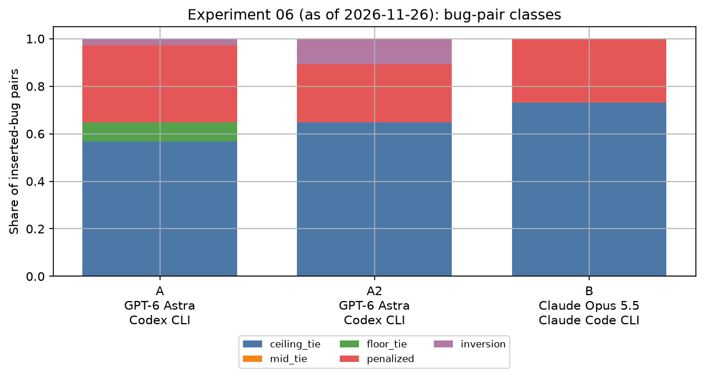
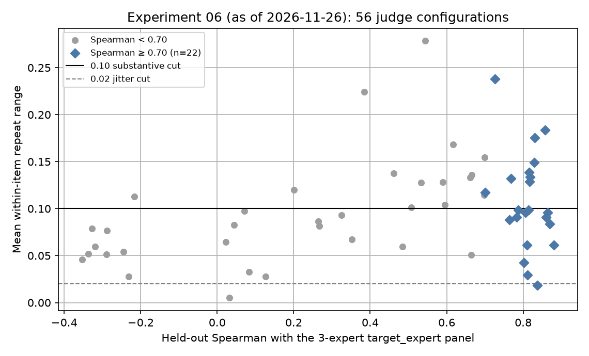

# Results: 06_why_human_correlation_misses_formal_properties (as of 2026-11-26)

Date: 2026-11-26. Preregistration: [PREREG.md](PREREG.md), committed at `f59f959` before this run. CPU reanalysis of public logs from experiments 03, 04, and 05. New model calls: none. Cost: $0.00. Intervals are 95% percentile bootstrap intervals, 2,000 draws, seed `20261124`, unless a row says it is a census. Analysis harness: Python 3, NumPy, SciPy, matplotlib (`scripts/analysis.py`).

## Takeaway

The overall verdict is **mixed**. The correlation and the properties are free to come apart, and on these logs they come apart in a specific way for the one judge configuration whose Spearman interval lies above 0.

- **The statistics do not force each other.** In experiment 05 the natural-file ids (`CRIT`) and the property ids (`BUG`, `RN_b`, `RN_d`, `ID1`) are disjoint (intersection 0) while 11 tasks appear in both sets. A constructed example with 45 items has median Spearman 1 and a repeat-violation rate of 1. Human correlation on one set of files cannot certify a property on another, and a correlation of medians cannot certify a small repeat range.
- **H-material is supported for judge LLM Claude Opus 5.5** (`claude-opus-5-5`), harness Claude Code CLI, Stanford plan, lane `stanford-claude`, rubric `P4_CHECKLIST`. The share of 37 bug pairs whose score drops by more than 0.20 is **0.108 [0.000, 0.226]** (11 tasks). 27 of 37 pairs are ceiling ties (`ID1 ≥ 0.95` and the bug stays within 0.05). The median drop is 0, which the published tie count (19 of 37) already implied; this run confirms it.
- **H-range is mixed.** Across the 22 experiment 03 configurations with held-out Spearman at least 0.70, the median within-item repeat range is **0.097**. The pre-registered substantive cut was 0.10 and the jitter cut was 0.02. Nine of the 22 are at or above 0.10. One is at or below 0.02. These ranges are swings of about half a point on a 0–5 scale, and the label stays mixed because 0.097 is under 0.10.
- **H-split is mixed.** On the 56 judge configurations (judge LLMs on `vb103_judge`, judge agents on `terminus2`), the partial Spearman of held-out human correlation with statement-weakening violations, given bug-tie rate, is **−0.766 [−0.847, −0.650]**, permutation p = 0.0002. The partial with bug-tie rate, given weakening, is **+0.302 [0.076, 0.478]**, p = 0.0240. Weakening tracks human correlation. Bug ties do not drop out: at a fixed weakening rate, higher human correlation goes with a higher bug-tie rate. The p-values shuffle these 56 configurations, which share models, prompts, and tasks.

The implementation-rubric arm was not run. It is the call that can tell whether those ceiling ties move when the rubric grades the definition.





## Verdicts

| Check | Set | Result | Number |
|---|---|---|---|
| H-material | B: Claude Opus 5.5, Claude Code CLI, Stanford, `P4_CHECKLIST` | supported | drop > 0.20: 0.108 [0.000, 0.226], n = 37, 11 tasks |
| H-range | 22 high-correlation configurations in experiment 03 | mixed | median repeat range 0.097 (p25 0.085, p75 0.133, min 0.019, max 0.238); 9/22 ≥ 0.10; 1/22 ≤ 0.02 |
| H-split | 56 judge configurations in experiment 03 | mixed | partial(ρ, V_weak \| V_bug) = −0.766 [−0.847, −0.650], p = 0.0002; partial(ρ, V_bug \| V_weak) = +0.302 [0.076, 0.478], p = 0.0240 |
| Overall | the three rows above | mixed | two mixed, one supported, none falsified |

H-range is a census of the logged high-correlation set, so it has no sampling interval in the verdict. The partial-correlation p-values are conditional on this logged set.

A note computed after the partial came out positive, not a preregistered test and with no interval: on the same 56 configurations, Spearman(V_bug, V_weak) = 0.459. The two violation rates move together. That is why the published marginal Spearman of human correlation with V_bug can be −0.164 while the partial, once weakening is residualized, is positive.

## Bug pairs (experiment 05)

Pair class, first match wins: inversion if the bug scores more than 0.05 above the gold, penalized if it scores more than 0.05 below, ceiling tie if the gold is at least 0.95, floor tie if both are at most 0.20, otherwise mid tie. Material means the drop exceeds 0.20. A and A2 are replication rows. Only B enters the overall verdict. Judge LLM GPT-6 Astra (`gpt-6-astra`), harness Codex CLI, Vals plan, lane `vals-codex`.

| Config | Judge LLM, harness, rubric | Ceiling | Penalized | Floor | Inversion | Material share [95% CI] | Label |
|---|---|---:|---:|---:|---:|---|---|
| A | GPT-6 Astra, Codex CLI, `P4_CHECKLIST` | 21/37 | 12/37 | 3/37 | 1/37 | 0.324 [0.061, 0.600] | mixed |
| A2 | GPT-6 Astra, Codex CLI, `P8_STRICT_B` | 24/37 | 9/37 | 0/37 | 4/37 | 0.243 [0.056, 0.447] | mixed |
| B | Claude Opus 5.5, Claude Code CLI, `P4_CHECKLIST` | 27/37 | 10/37 | 0/37 | 0/37 | 0.108 [0.000, 0.226] | supported |

Mid tie is 0/37 in every configuration. For A and A2 the penalized count equals the material count: when the score moves by more than 0.05, it also moves by more than 0.20, and the task-cluster interval on that share is wide (11 tasks). For B, 10 pairs move by more than 0.05 and 4 of those move by more than 0.20. By bug level, B's material counts are 0/11, 1/9, 2/9, and 1/8 at levels 1 through 4. Level 1 has a material share 0.000 [0.000, 0.000]. The deeper levels stay compatible with a small share; their intervals run up to 0.333, 0.556, and 0.375.

The median drop is 0.000 for all three, with intervals [0.000, 1.000] for A, [0.000, 0.000] for A2, and [0.000, 0.050] for B. Exact ties: 24, 24, and 19. A's median interval runs out to 1 because a few tasks have large drops and the cluster bootstrap of a median can jump. The confirmatory number is the material share, not that median.

## Two score regimes, and renames

Mean gold-as-candidate (`ID1`) minus mean natural file (`CRIT`):

| Config | ID1 − CRIT [95% CI] | Natural files at ≤ 0.20 |
|---|---|---|
| A | 0.757 [0.628, 0.869] | 61/75 |
| A2 | 0.845 [0.757, 0.907] | 71/75 |
| B | 0.778 [0.725, 0.826] | 52/75 |

The 61 and 71 counts match experiment 05. B's 52/75 was not in that writeup. For B, the natural-file mean is 0.218 [0.169, 0.271] and the gold-as-candidate mean is 0.996 [0.990, 1.000]. The correlation is computed on the low scores. The bug property is computed where the gold sits at the ceiling.

Task-level Spearman of the mean natural-file score with the mean bug drop, 11 shared tasks, intervals that all cover 0: A −0.139 [−0.645, 0.499], A2 −0.046 [−0.778, 0.687], B −0.256 [−0.770, 0.403]. With 11 tasks these intervals are wide.

Declaration renames for B (`RN_d`, n = 24): the share moving down by more than 0.05 is 0.375 [0.167, 0.583], and the share moving down by more than 0.20 is 0.000 [0.000, 0.000]. The point 0.375 matches experiment 05. Experiment 05's interval was [0.208, 0.583], from one generator consumed across that experiment's statistics; this run starts a fresh generator per statistic. Binder renames (`RN_b`, n = 14) are unchanged: 1.000 [1.000, 1.000].

## Statement weakening versus bug ties

| Partial Spearman on the 56 configurations | Estimate [95% CI] | Permutation p |
|---|---|---|
| ρ with V_weak, given V_bug | −0.766 [−0.847, −0.650] | 0.0002 |
| ρ with V_bug, given V_weak | +0.302 [0.076, 0.478] | 0.0240 |

The weakening partial meets the pre-registered tracking cut (point ≤ −0.40, interval upper bound < −0.20, p < 0.05). The bug partial does not meet the "absent" cut: the absolute point is 0.302, above 0.25, and the interval does not cover 0. It also does not meet the falsifying cut, which required a negative tracking partial. Marginal Spearman(ρ, V_weak) recomputed here is −0.7470214475096882, matching the stored experiment 03 value with absolute difference 0.

## Repeat range on the 22

Judge configurations with held-out Spearman ≥ 0.70 and coverage ≥ 0.90: 17 judge LLMs on `vb103_judge` and 5 judge agents on `terminus2`. The alignment gate matched experiment 03's failing list, and every one of the 22 has V_bug strict-greater share 0.

| | Repeat range (mean of max − min across repeats) |
|---|---|
| min | 0.019 |
| p25 | 0.085 |
| median | 0.097 |
| p75 | 0.133 |
| max | 0.238 |

The per-configuration rows are in [results/exp03_configurations.csv](results/exp03_configurations.csv).

## Experiment 04, descriptive ratio

Point ratio `harsh_flip_eq10 / V_equiv` on every `M1_deployed_tc_v1` row. No new interval: the public CSV does not hold the pair-level draws. A ratio of 1 means that whenever the two equivalent references received different coverage scores, they also disagreed on the full-credit bit. `mean_abs` is the mean absolute coverage shift, which can be modest while the bit still flips.

| Config | Harness | Model | n | V_equiv | harsh bit flip | mean abs shift | Ratio | Read while writing the PREREG |
|---|---|---|---:|---:|---:|---:|---:|---|
| `claude-sonnet-4-6::M1` | `claude-p-cli` | `claude-sonnet-4-6` | 12 | 0.750 | 0.750 | 0.417 | 1 | yes |
| `gpt-5.4::M1` | `openai-api` | `gpt-5.4` | 13 | 0.615 | 0.615 | 0.300 | 1 | yes |
| `leanstral::M1` | `mistral-api` | `labs-leanstral-1-5-1` | 10 | 0.300 | 0.300 | 0.160 | 1 | no |
| `ministral-14b::M1` | `mistral-api` | `ministral-14b-2512` | 4 | 0.750 | 0.750 | 0.325 | 1 | no |
| `ministral-8b::M1` | `mistral-api` | `ministral-8b-2512` | 4 | 0.500 | 0.500 | 0.250 | 1 | no |
| `qwen3.5-9b::M1` | `ollama-local` | `qwen3.5:9b-q4_K_M` | 5 | 0.800 | 0.800 | 0.640 | 1 | no |

## What this leaves open

The ceiling pattern on Claude Opus 5.5 is what the unrun implementation rubric is for. Arm S is the logged `P4_CHECKLIST` scores. Arm I would rescore `ID1`, `ID2`, `RN_b`, `RN_d`, and `BUG` under the rubric frozen in `PREREG.md`, same harness and judge LLM, Stanford lane `stanford-claude`. Support for "the statement rubric was the reason" requires V_bug ≤ 0.20 with interval upper bound < 0.40 and mean drop ≥ 0.30, on a complete 24 + 37 score file. That command was not launched.

```bash
python3 experiments/06_why_human_correlation_misses_formal_properties/scripts/judge_implementation_rubric.py \
  --probes ~/at3450/probes.jsonl \
  --lanes stanford-claude \
  --out ~/at3450/exp06_arm_I \
  --confirm-plan-spend
```

## Limits

1. One confirmatory judge configuration. A and A2 do not have a Spearman interval above 0.
2. Eleven tasks underlie the 37 bug pairs. The material interval for B still reaches 0.226.
3. The 56 and the 22 share models, prompts, and tasks. The partial p-values are a conditional check on that set.
4. Humans were not asked to score these bug probes, so this run does not say whether a human rater would have dropped the score.
5. Experiment 03's repeat ranges are the stored means. The public repository does not hold the per-repeat scores, so those means were not rebuilt from draws.
6. The median drop of 0 is a corollary of a published tie rate above one half. It is a check, not a new result.
7. Open-weight `M1` rows have 4 to 10 tasks. The ratio of 1 on those rows is a point estimate.

## Alignment

Experiment 05: recomputed V_bug, tie share, strict share, mean drop, ID1 mean, and kind counts match `summary.json` within 1e-9 for A, A2, and B. Natural-file counts at ≤ 0.20 are 61 and 71 for A and A2. Lanes and model ids match `vals-codex` / `gpt-6-astra` and `stanford-claude` / `claude-opus-5-5`.

Experiment 03: 56 configurations, Spearman with V_weak matches the stored value exactly at the recorded precision, 22 high-correlation configurations are 17 on `vb103_judge` and 5 on `terminus2`, and the id set matches `failing_high_corr_llms`.

Class shares sum to 1. Probe-id intersections with `CRIT` are 0.

## Machine lines

Checked against `results/summary.json` by `scripts/test_analysis.py`.

```text
OVERALL mixed
H-material B supported share(drop>0.20)=0.108 [0.000, 0.226] n=37 tasks=11 judge_llm=Claude Opus 5.5 harness=Claude Code CLI plan=Stanford rubric=P4_CHECKLIST
H-range mixed median=0.097 p25=0.085 p75=0.133 min=0.019 max=0.238 n_ge_0.10=9 n_le_0.02=1 n=22
H-split mixed partial(rho,V_weak|V_bug)=-0.766 [-0.847, -0.650] p=0.0002 partial(rho,V_bug|V_weak)=0.302 [0.076, 0.478] p=0.0240 n=56
SLACK spearman_of_medians=1.0 v_rep=1.0 n_items=45
ARM_I not_run
ALIGN exp03_spearman_abs_diff=0.000e+00 n_llm=56 n_high=22
CLASSES A ceiling_tie=21/37 mid_tie=0/37 floor_tie=3/37 penalized=12/37 inversion=1/37 material=0.324 [0.061, 0.600] label=mixed judge_llm=GPT-6 Astra harness=Codex CLI rubric=P4_CHECKLIST
MEDIAN_DROP A 0.000 [0.000, 1.000] corollary_zero=true n_exact_ties=24
GAP A id1_minus_crit=0.757 [0.628, 0.869] crit_le_0.20=61/75
TASK_SPEARMAN A reported -0.139 [-0.645, 0.499] n_tasks=11 shared_tasks=11
DISJOINT A BUG=0 RN_b=0 RN_d=0 ID1=0
CLASSES A2 ceiling_tie=24/37 mid_tie=0/37 floor_tie=0/37 penalized=9/37 inversion=4/37 material=0.243 [0.056, 0.447] label=mixed judge_llm=GPT-6 Astra harness=Codex CLI rubric=P8_STRICT_B
MEDIAN_DROP A2 0.000 [0.000, 0.000] corollary_zero=true n_exact_ties=24
GAP A2 id1_minus_crit=0.845 [0.757, 0.907] crit_le_0.20=71/75
TASK_SPEARMAN A2 reported -0.046 [-0.778, 0.687] n_tasks=11 shared_tasks=11
DISJOINT A2 BUG=0 RN_b=0 RN_d=0 ID1=0
CLASSES B ceiling_tie=27/37 mid_tie=0/37 floor_tie=0/37 penalized=10/37 inversion=0/37 material=0.108 [0.000, 0.226] label=supported judge_llm=Claude Opus 5.5 harness=Claude Code CLI rubric=P4_CHECKLIST
MEDIAN_DROP B 0.000 [0.000, 0.050] corollary_zero=true n_exact_ties=19
GAP B id1_minus_crit=0.778 [0.725, 0.826] crit_le_0.20=52/75
TASK_SPEARMAN B reported -0.256 [-0.770, 0.403] n_tasks=11 shared_tasks=11
DISJOINT B BUG=0 RN_b=0 RN_d=0 ID1=0
EXP04_M1 claude-sonnet-4-6::M1_deployed_tc_v1 ratio=1.000 V_equiv=0.750 harsh_eq10=0.750 seen_at_prereg=true harness=claude-p-cli model=claude-sonnet-4-6
EXP04_M1 gpt-5.4::M1_deployed_tc_v1 ratio=1.000 V_equiv=0.615 harsh_eq10=0.615 seen_at_prereg=true harness=openai-api model=gpt-5.4
EXP04_M1 leanstral::M1_deployed_tc_v1 ratio=1.000 V_equiv=0.300 harsh_eq10=0.300 seen_at_prereg=false harness=mistral-api model=labs-leanstral-1-5-1
EXP04_M1 ministral-14b::M1_deployed_tc_v1 ratio=1.000 V_equiv=0.750 harsh_eq10=0.750 seen_at_prereg=false harness=mistral-api model=ministral-14b-2512
EXP04_M1 ministral-8b::M1_deployed_tc_v1 ratio=1.000 V_equiv=0.500 harsh_eq10=0.500 seen_at_prereg=false harness=mistral-api model=ministral-8b-2512
EXP04_M1 qwen3.5-9b::M1_deployed_tc_v1 ratio=1.000 V_equiv=0.800 harsh_eq10=0.800 seen_at_prereg=false harness=ollama-local model=qwen3.5:9b-q4_K_M
```

## Reproduce

```bash
python3 experiments/06_why_human_correlation_misses_formal_properties/scripts/analysis.py
python3 -m unittest experiments/06_why_human_correlation_misses_formal_properties/scripts/test_analysis.py -v
```
