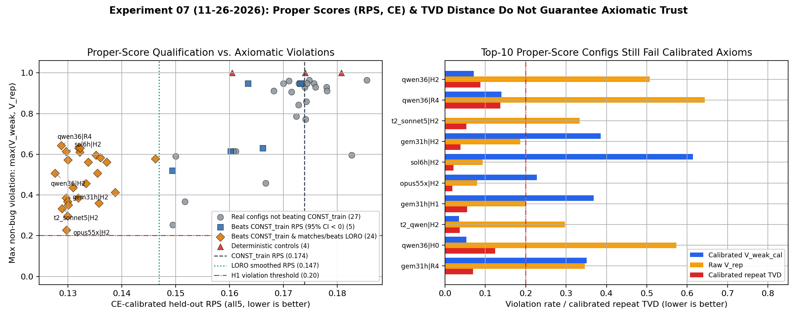
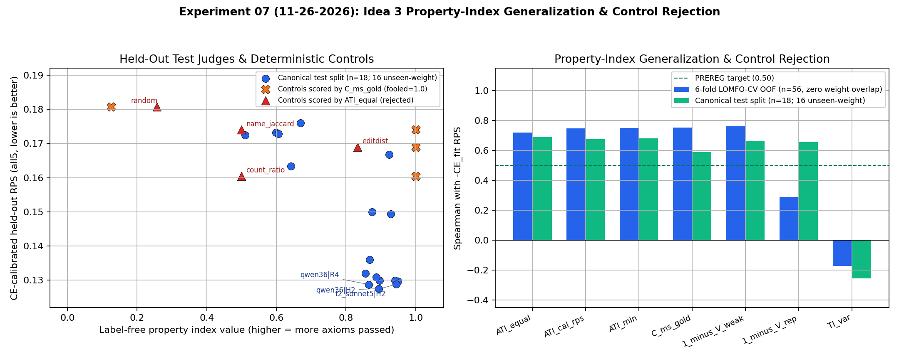
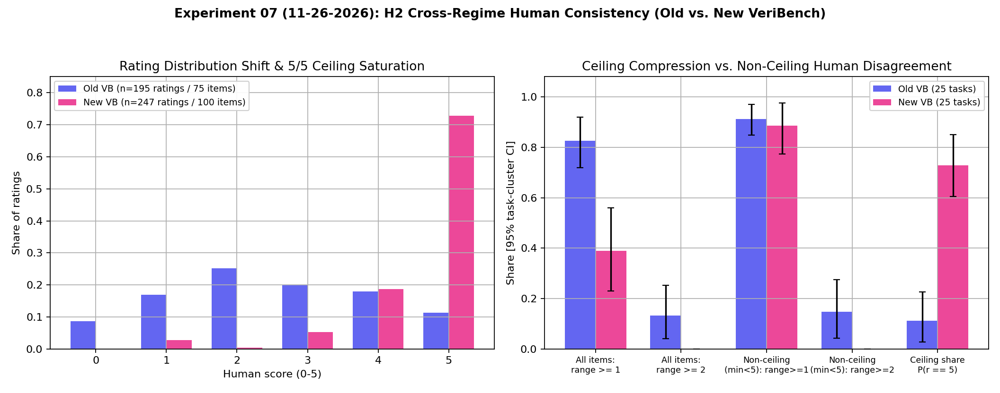

# Results: 07_proper_scores_are_not_trust_and_amortized_property_certification (as of 2026-11-26)

Date: `2026-11-26`. **Preregistration:** [PREREG.md](PREREG.md) (committed at [`f76703c`](https://github.com/brando90/correlation-is-not-trust/commit/f76703c) before any run, with dated terminology/scope amendment).
**Cost & Harness:** Zero new model calls (`$0.00`), CPU-only Python 3 (`numpy`, `scipy`, `matplotlib`) in `scripts/analysis.py`.
**Alignment Gates:** **PASS** — Gate A1 (`436/436` checks vs. `cert-judge` Experiment `68` `study_b_e39_proper_scores.json`, `max_abs_diff = 3.33e-16 <= 1e-9`); Gate A2 (`480/480` checks vs. Experiment `03` `summary.json`, `max_abs_diff = 0.00e+00 <= 1e-9`).

## Takeaway

- **H1-proper is SUPPORTED (`29 / 29` `CONST_train`-beating, `27 / 27` all-3-metric, and `24 / 24` matched-`LORO` judge configurations still fail non-bug axiomatic properties):** Out of `56` real Lean 4 judge configurations (`50` `vb103_judge` judge LLMs and `6` `terminus2` judge agents) calibrated strictly on `30` train items (`10` tasks) via cumulative-logit `fit_ce_ordinal` and evaluated on up to `45` held-out items (`15` tasks, `all5` target; `9` `D0` configs on `42/45`, `qwen36|LEX` on `44/45`), **`29`** strictly beat `CONST_train` `RPS` (`0.1739 [0.1424, 0.2085]` on `45/45`, paired `95%` task-cluster CI `< 0`), **`27`** beat `CONST_train` on proper scores `RPS` and `CE` plus empirical distribution distance `TVD`, and **`24`** match or beat their matched-item human `LORO` smoothed ceiling (`RPS <= 0.1469 [0.1254, 0.1687]`, `CE <= 1.6667 [1.4768, 1.8660]` on `45/45`; `RPS <= 0.1525` on the `42/45` `D0` slice). Yet **`100%` (`29/29`, `27/27`, `24/24`) fail `V_weak >= 0.20` or `V_rep >= 0.20` (`95%` CI lower bound `> 0.05`, excluding `V_bug`)**. Passing to calibrated distributions does not repair these failures: `V_weak_cal == V_weak` holds across all `29/29` positively oriented (`b > 0`) `Q_const_rps` configurations (differing on `15/60` negatively correlated or near-zero-slope units across the full set, e.g., `ctl|editdist`: `0.000 -> 1.000`), and repeat variance produces non-trivial predictive distribution shifts (`rep_cal_tvd` up to `0.137 [0.085, 0.193]` and expected-score swings up to `0.612` points on `0–5` for `qwen36|R4`).
- **H-Idea3 is SUPPORTED under the literal preregistered full-`Q_const_rps` rule and under the leak-free `ATI_min` + `Gate_all` extension, whereas the strictly leak-free `train+val` continuous cutoff gives `FALSIFIED` (`3/4`) on `ATI_equal` and `ATI_cal_rps`:**
  - *Generalization:* On the canonical held-out `test` split (`n = 18`; `16` unseen-weight configs plus `2` `t2_sonnet5` agent configs sharing base weights with `train`), parameter-free `ATI_equal` predicts `-CE_fit RPS` at **Spearman = `0.690 [0.318, 0.881]` (`p = 0.0020`, within-family `p = 0.0004`, `RPS` regret `0.0022`)**, `ATI_min` reaches **`0.681 [0.276, 0.897]` (`p = 0.0032`, regret `0.0022`)**, and `ATI_cal_rps` reaches **`0.676 [0.247, 0.887]` (`p = 0.0022`, regret `0.0013`)**. Under strictly zero-weight-overlap evaluation (`test_unseen_weights`, `n = 16`), Spearman is `0.685 [0.281, 0.872]` (`ATI_equal`), `0.696 [0.245, 0.914]` (`ATI_min`), and `0.641 [0.172, 0.873]` (`ATI_cal_rps`); on `6`-fold grouped `LOMFO-CV` (`n = 56`), fixed-index OOF Spearman is **`0.721 [0.586, 0.806]` (`p = 0.0002`)** for `ATI_equal` and **`0.750 [0.608, 0.843]` (`p = 0.0002`)** for `ATI_min`, while pooled fitted `ATI_cal_rps` has descriptive Spearman `0.748` (6-fold mean within-fold Spearman `0.782`, mean regret `0.0081`, max regret `0.0370` vs. `0.0154`/`0.0530` for `ATI_equal` and `0.0093`/`0.0530` for `ATI_min`).
  - *Control rejection & leak-free distinction:* Under the literal preregistered `median(Q_const_rps)` cutoff (`n = 29`, which includes `11` test-split configs), `ATI_equal` rejects **`4/4`** deterministic controls (`0.833 < 0.868` on `ctl|editdist`), yielding literal `verdict_h_idea3_prereg_literal = supported`. Restricting the threshold strictly to `train+val` qualified configs (`n = 18`, zero test leakage) lowers `ATI_equal`'s cutoff to `0.817`, so both preregistered candidates reject only **`3/4`** controls (`ctl|editdist` passes continuous `ATI_equal = 0.833` and `ATI_cal_rps = -0.123 >= -0.142`), giving `verdict_h_idea3_leak_free_prereg = falsified`. Under the non-preregistered worst-case extension **`ATI_min`** (`0.000 < 0.459`, **`4/4`**) and hard **`Gate_all`** (**`0/4`** controls pass, **`0/56`** real configs pass), all `4/4` deterministic controls are rejected with zero test leakage (`verdict_h_idea3_leak_free_extension_ati_min = supported`). By comparison, single-property `C_ms_gold` only rejects `1/4` (`1.000` on three controls) and `TI_var_trainnorm` fails prediction (`-0.255`) and control rejection on full `Q` (`0/4` full `Q`, `3/4` `train+val` `Q`).
- **H2-new is SUPPORTED (New VeriBench `5/5` ceiling saturation masks `88.6%` non-ceiling human disagreement):** On New VeriBench (`100` items / `25` tasks, `247` ratings), the prespecified rating-weighted ceiling prevalence is **`0.729 [0.605, 0.850]`** (item-weighted sensitivity `0.717 [0.593, 0.837]`), versus **`0.113 [0.028, 0.226]`** (item-weighted `0.147 [0.040, 0.280]`) on Old VeriBench (`75` items / `25` tasks, `195` ratings), driving unanimous share to `0.610 [0.440, 0.770]` and shrinking the irreducible `RPS` floor from `0.045 [0.037, 0.055]` to `0.019 [0.011, 0.027]`. However, conditioned on the **`44/100` non-ceiling items (`min < 5`, `13` tasks)**, human raters still disagree (`range >= 1`) on **`0.886 [0.773, 0.977]`** of items with pairwise exact agreement **`0.235 [0.151, 0.341]`** (no higher than Old VeriBench non-ceiling `0.275 [0.205, 0.343]`).



---

## Part A (`H1-proper`): Proper Scores (`RPS`, `CE`) & `TVD` Distance vs. Raw & Calibrated Axiomatic Violations

All proper scores (`RPS`, `CE`) and distribution distance (`TVD`) are evaluated on each config's scored held-out items (`45/45` across `15` tasks, except `42/45` for `9` `D0` configs and `44/45` for `qwen36|LEX`) after train-only (`30` items, `10` tasks) ordinal calibration `fit_ce_ordinal`. Baselines on all `45` items: `CONST_train` (`RPS = 0.1739 [0.1424, 0.2085]`, `CE = 1.7537 [1.6305, 1.8895]`, `TVD = 0.5025 [0.4472, 0.5604]`, `Brier = 0.8248 [0.7871, 0.8639]`) and human `LORO` smoothed (`RPS = 0.1469 [0.1254, 0.1687]`, `CE = 1.6667 [1.4768, 1.8660]`, `TVD = 0.7630 [0.7193, 0.8066]`; matched `LORO RPS` on `42` items is `0.1525`, and on `44` items `0.1459`). Note on `TVD`: unlike `RPS`, `CE`, and `Brier`, `TVD` is a distribution distance (not strictly proper for single rater outcomes); `LORO TVD` averages single-rater point-mass loss `1 - q_s(y)` (hence excluded from `Q_loro_rps`), whereas judge and `CONST_train` `TVD` measure distance to the 5-rater empirical distribution `p_emp`. Note on `Model`: `gem31h` served as `google/gemini-3.1-pro-preview` (declared `google/gemini-3.1-pro-preview-high`) and `qwen36`/`t2_qwen` served as `alibaba/qwen3.6-27b` (declared `alibaba/qwen3.6-27b-thinking`), while all other models match `model_declared == model_served`.

Table 1 lists the top `15` of `29` configurations in `Q_const_rps` (all `60` units and exact `n_heldout_items` / `matched_loro_rps` columns in [part_a_proper_scores_vs_properties.csv](results/part_a_proper_scores_vs_properties.csv); across all `29/29` positively oriented `Q_const_rps` configs, `V_weak_cal == V_weak`). Intervals are `2,000`-draw task-cluster bootstrap 95% CIs; `dRPS p` is the `2,000`-draw two-sided item-weighted task sign-flip permutation `p-val` vs. `CONST_train`.

| Config (`n` items) | Harness | Model (`model_declared`) | `CE_fit` `RPS` [95% CI], `dRPS p` | `CE_fit` `CE` [95% CI] | `CE_fit` `TVD` [95% CI] | `ICC(A,1)` / `Spearman` | `V_weak` (= `V_weak_cal` on `Q_const_rps`) [95% CI] | `V_rep` [95% CI] | Cal. `rep_cal_tvd` [95% CI] (`rEV_05`) | Triggers (`H1-proper`) |
|---|---|---|---|---|---|---|---|---|---|---|
| `qwen36\|H2` (45) | `vb103_judge` (judge LLM) | `alibaba/qwen3.6-27b-thinking` | **0.1275** [0.1051, 0.1521], `0.0125` | **1.4944** [1.3200, 1.6686] | **0.3969** [0.3640, 0.4249] | 0.834 / 0.805 | 0.071 [0.018, 0.140] | **0.507** [0.370, 0.644] | 0.088 [0.049, 0.136] (`0.342`) | `V_rep` |
| `qwen36\|R4` (45) | `vb103_judge` (judge LLM) | `alibaba/qwen3.6-27b-thinking` | **0.1288** [0.1062, 0.1522], `0.0270` | **1.5062** [1.3300, 1.6753] | **0.4035** [0.3594, 0.4396] | 0.865 / 0.829 | 0.140 [0.053, 0.228] | **0.644** [0.486, 0.786] | 0.137 [0.085, 0.193] (`0.612`) | `V_rep` |
| `t2_sonnet5\|H2` (45) | `terminus2` (judge agent) | `anthropic/claude-sonnet-5-medium` | **0.1288** [0.1077, 0.1521], `0.0150` | **1.5031** [1.3496, 1.6657] | **0.4020** [0.3665, 0.4308] | 0.828 / 0.850 | 0.000 [0.000, 0.000] | **0.333** [0.213, 0.453] | 0.053 [0.024, 0.089] (`0.230`) | `V_rep` |
| `gem31h\|H2` (45) | `vb103_judge` (judge LLM) | `google/gemini-3.1-pro-preview-high` | **0.1296** [0.1094, 0.1515], `0.0185` | **1.5036** [1.3540, 1.6539] | **0.4047** [0.3601, 0.4408] | 0.840 / 0.904 | **0.386** [0.246, 0.544] | 0.187 [0.093, 0.280] | 0.039 [0.014, 0.066] (`0.176`) | `V_weak` |
| `sol6h\|H2` (45) | `vb103_judge` (judge LLM) | `openai/gpt-6-sol-high` | **0.1296** [0.1095, 0.1514], `0.0265` | **1.4998** [1.3553, 1.6477] | **0.4061** [0.3686, 0.4358] | 0.841 / 0.829 | **0.614** [0.421, 0.789] | 0.093 [0.027, 0.173] | 0.021 [0.005, 0.042] (`0.097`) | `V_weak` (+`V_overc`) |
| `opus55x\|H2` (45) | `vb103_judge` (judge LLM) | `anthropic/claude-opus-5-5-no-fallback` | **0.1297** [0.1083, 0.1528], `0.0220` | **1.5022** [1.3461, 1.6649] | **0.4006** [0.3620, 0.4304] | 0.834 / 0.848 | **0.228** [0.140, 0.316] | 0.080 [0.027, 0.147] | 0.019 [0.003, 0.037] (`0.078`) | `V_weak` |
| `gem31h\|H1` (45) | `vb103_judge` (judge LLM) | `google/gemini-3.1-pro-preview-high` | **0.1299** [0.1087, 0.1528], `0.0220` | **1.5027** [1.3512, 1.6632] | **0.4029** [0.3640, 0.4339] | 0.837 / 0.869 | **0.368** [0.228, 0.527] | **0.200** [0.107, 0.293] | 0.055 [0.026, 0.089] (`0.256`) | `V_weak`, `V_rep` |
| `t2_qwen\|H2` (45) | `terminus2` (judge agent) | `alibaba/qwen3.6-27b-thinking` | **0.1299** [0.1101, 0.1515], `0.0095` | **1.5092** [1.3713, 1.6526] | **0.4116** [0.3755, 0.4411] | 0.807 / 0.846 | 0.035 [0.000, 0.088] | **0.297** [0.197, 0.403] | 0.037 [0.014, 0.066] (`0.164`) | `V_rep` |
| `qwen36\|H0` (45) | `vb103_judge` (judge LLM) | `alibaba/qwen3.6-27b-thinking` | **0.1300** [0.1050, 0.1569], `0.0380` | **1.5142** [1.3142, 1.7080] | **0.4015** [0.3535, 0.4419] | 0.835 / 0.806 | 0.053 [0.000, 0.105] | **0.573** [0.427, 0.720] | 0.124 [0.077, 0.171] (`0.497`) | `V_rep` |
| `gem31h\|R4` (45) | `vb103_judge` (judge LLM) | `google/gemini-3.1-pro-preview-high` | **0.1301** [0.1059, 0.1561], `0.0385` | **1.5082** [1.3199, 1.6919] | **0.4013** [0.3552, 0.4389] | 0.846 / 0.806 | **0.351** [0.211, 0.509] | **0.347** [0.253, 0.440] | 0.069 [0.043, 0.102] (`0.301`) | `V_weak`, `V_rep` (+`V_overc`) |
| `t2_qwen\|D0` (42) | `terminus2` (judge agent) | `alibaba/qwen3.6-27b-thinking` | **0.1309** [0.1077, 0.1552], `0.0225` | **1.5075** [1.3173, 1.6862] | **0.3877** [0.3369, 0.4303] | 0.843 / 0.822 | **0.246** [0.175, 0.316] | **0.437** [0.310, 0.565] | 0.075 [0.039, 0.116] (`0.298`) | `V_weak`, `V_rep` |
| `sonnet5m\|H2` (45) | `vb103_judge` (judge LLM) | `anthropic/claude-sonnet-5-medium` | **0.1319** [0.1042, 0.1630], `0.0455` | **1.5252** [1.3120, 1.7514] | **0.4010** [0.3565, 0.4369] | 0.804 / 0.788 | 0.055 [0.000, 0.113] | **0.387** [0.280, 0.507] | 0.074 [0.041, 0.107] (`0.304`) | `V_rep` |
| `qwen36\|H1` (45) | `vb103_judge` (judge LLM) | `alibaba/qwen3.6-27b-thinking` | **0.1320** [0.1065, 0.1595], `0.0395` | **1.5196** [1.3325, 1.7152] | **0.4116** [0.3717, 0.4425] | 0.816 / 0.837 | 0.018 [0.000, 0.053] | **0.630** [0.500, 0.747] | 0.127 [0.081, 0.178] (`0.530`) | `V_rep` |
| `sonnet5m\|D0` (42) | `vb103_judge` (judge LLM) | `anthropic/claude-sonnet-5-medium` | **0.1322** [0.1092, 0.1529], `0.0230` | **1.5176** [1.3184, 1.6870] | **0.3946** [0.3423, 0.4434] | 0.827 / 0.818 | 0.140 [0.070, 0.211] | **0.611** [0.446, 0.767] | 0.091 [0.053, 0.127] (`0.398`) | `V_rep` |
| `sol6h\|H1` (45) | `vb103_judge` (judge LLM) | `openai/gpt-6-sol-high` | **0.1322** [0.1149, 0.1508], `0.0120` | **1.5207** [1.3989, 1.6426] | **0.4174** [0.3783, 0.4511] | 0.796 / 0.823 | **0.632** [0.439, 0.825] | 0.173 [0.107, 0.253] | 0.021 [0.008, 0.038] (`0.098`) | `V_weak` (+`V_overc`) |

Sensitivity on `expert3`: `24/24` configs beating `CONST_train_exp3` (`RPS = 0.1756 [0.1415, 0.2111]`) still trigger `H1-proper` (`V_weak` or `V_rep`, excluding `V_bug`). Across the `29` `Q_const_rps` configs, `V_rep_heldout` reconstructed directly from raw `E39` `crit` repeats matches full-set `V_rep` closely (`0` clean passes).

---

## Part B (`H-Idea3`): Property-Index Generalization Across Model Families & Control Rejection

On `train+val` (`n = 38` real configs), inner LOMFO-CV chose `lambda = 0.01` for `ATI_cal_rps` with nonnegative Ridge weights `pass_ms = 0.0865`, `pass_vac = 0.0447`, `pass_weak = 0.0378`, `pass_rep = 0.0202`, `pass_fmt = 0.0149`, `pass_overc = 0.0000` (intercept `-0.3244`). All five target associations (Spearman, 95% CI, permutation `p-val`, and `within_family_p` for `-RPS`, `-CE`, `-TVD`, `ICC(A,1)`, and raw `expert3` Spearman) are exported in [part_b_idea3_certification.csv](results/part_b_idea3_certification.csv). Notice: `test` (`n = 18`) is the canonical held-out split (`16` unseen-weight configs + `2` `t2_sonnet5` agent configs sharing `sonnet5m` weights with `train`), while `test_unseen_weights` (`n = 16`) and grouped `6`-fold `LOMFO-CV` (`n = 56`, grouping `terminus2` agents with base model weights) are strictly zero-weight-overlap out-of-family evaluations.

| Split (`n`) | Index | Spearman `-RPS` [95% CI] | `p-val` (`within-fam p`) | `CE` / `TVD` / `ICC(A,1)` Spearman | `Regret RPS` | Picked Config | Controls Rejected (`full Q` / `train+val Q`) |
|---|---|---|---:|---|---:|---|---:|
| `test` (18) | **`ATI_equal`** | **0.690** [0.318, 0.881] | `0.0020` (`0.0004`) | 0.717 / 0.699 / 0.628 | **0.0022** | `opus55x\|H2` | **4/4** / 3/4 |
| `test` (18) | **`ATI_min`** | **0.681** [0.276, 0.897] | `0.0032` (`0.0012`) | 0.729 / 0.731 / 0.611 | **0.0022** | `opus55x\|H2` | **4/4** / **4/4** |
| `test` (18) | **`ATI_cal_rps`** | **0.676** [0.247, 0.887] | `0.0022` (`0.0008`) | 0.682 / 0.649 / 0.602 | **0.0013** | `t2_sonnet5\|H2` | 3/4 / 3/4 |
| `test` (18) | `ATI_plus_bug` | 0.604 [0.123, 0.842] | `0.0102` (`0.0018`) | 0.637 / 0.628 / 0.571 | 0.0392 | `opus55x\|D0` | 3/4 / 3/4 |
| `test` (16) | `C_ms_gold` | 0.589 [0.114, 0.814] | `0.0170` (`0.0230`) | 0.630 / 0.675 / 0.664 | 0.0084 | `t2_sonnet5\|D0` | **1/4** / **1/4** |
| `test` (18) | `1 - V_weak` | 0.665 [0.207, 0.884] | `0.0042` (`0.0042`) | 0.618 / 0.598 / 0.578 | 0.0202 | `opus55x\|D0\|t2_sonnet5\|H2` | 3/4 / 3/4 |
| `test` (18) | `1 - V_rep` | 0.657 [0.217, 0.887] | `0.0048` (`0.0014`) | 0.709 / 0.707 / 0.614 | 0.0022 | `opus55x\|H2` | 0/4 / 0/4 |
| `test` (18) | `1 - V_fmt` | 0.523 [0.258, 0.764] | `0.0224` (`0.0226`) | 0.523 / 0.523 / 0.608 | 0.0166 | 15-way tie | 2/4 / 2/4 |
| `test` (18) | `1 - V_bug` | 0.433 [-0.070, 0.779] | `0.0744` (`0.0420`) | 0.450 / 0.465 / 0.438 | 0.0392 | `opus55x\|D0` | 3/4 / 3/4 |
| `test` (18) | `TI_var_trainnorm` | -0.255 [-0.655, 0.199] | `0.2895` (`0.3305`) | -0.233 / -0.142 / -0.144 | 0.0392 | `opus55x\|D0` | **0/4** / **3/4** |
| `test_unseen_weights` (16) | `ATI_equal` / `ATI_min` / `ATI_cal_rps` | 0.685 [0.281, 0.872] / 0.696 [0.245, 0.914] / 0.641 [0.172, 0.873] | `0.0042` / `0.0036` / `0.0094` | 0.688 / 0.729 / 0.629 (`CE`) | 0.0022 / 0.0022 / 0.0024 | `opus55x\|H2` / `t2_qwen\|H2` | 4/4 / 4/4 / 3/4 (tv: 3/4 / 4/4 / 3/4) |
| `lomfo_oof_all` (56) | **`ATI_equal` / `ATI_min`** | **0.721 [0.586, 0.806]** / **0.750 [0.608, 0.843]** | `0.0002` (`0.0002`) | 0.710 / 0.750 (`CE`), 0.753 / 0.781 (`TVD`) | `0.0022` / `0.0022` | `opus55x\|H2` | 4/4 / 4/4 (tv: 3/4 / 4/4) |
| `lomfo_oof_all` (56) | **`ATI_cal_rps` (pooled fitted*)** | `0.748` (descriptive only) | `n/a` (pooled fitted) | `0.739` (`CE`), `0.763` (`TVD`) | `0.0392` (pooled*) | `opus55x\|D0` (pooled*) | 3/4 / 3/4 (on `train+val` fit) |

\* Pooled fitted `ATI_cal_rps` OOF predictions depend on other folds' outcome labels and mix fold intercepts/penalties (`lambda = 0.1` on `sonnet5m` vs. `0.01`), so inferential fixed-predictor CIs/p-values are omitted and cross-fold pooled `argmax` incurs `0.0392` `RPS` regret; valid fold-by-fold LOMFO performance is given below.

- **6-fold LOMFO-CV mean / max selection regret (`RPS`) and per-fold regrets (`summary.json["part_b"]["lomfo_fold_summary"]`):**
  - `ATI_equal`: **mean `0.0154`**, **max `0.0530`** (`sol6h`); per-fold Spearman `0.818` (`qwen36`, regret `0.0024`), `0.900` (`opus55x`, `0.0000`), `0.827` (`sonnet5m`, `0.0000`), `0.800` (`gem31h`, `0.0091`), `0.565` (`luna6h`, `0.0278`), `0.300` (`sol6h`, `0.0530`).
  - `ATI_min`: **mean `0.0093`**, **max `0.0530`** (`sol6h`); per-fold regrets `0.0024` (`qwen36`), `0.0000` (`opus55x`), `0.0000` (`sonnet5m`), `0.0005` (`gem31h`), `0.0000` (`luna6h`), `0.0530` (`sol6h`).
  - `ATI_cal_rps`: **mean `0.0081`**, **max `0.0370`** (`opus55x`); per-fold Spearman `0.773` (`qwen36`, regret `0.0024`), `0.700` (`opus55x`, `0.0370`), `0.864` (`sonnet5m`, `0.0000`), `0.783` (`gem31h`, `0.0091`), `0.875` (`luna6h`, `0.0000`), `0.700` (`sol6h`, `0.0000`).
- **Deterministic control check & hard `Gate_all`:** `Gate_all` passes **`0/4`** controls AND **`0/56`** real configs (`sol6h|H2` fails `V_weak` & `V_overc`; `qwen36|H2` & `t2_sonnet5|H2` fail `V_rep`; `opus55x|H2` fails `V_weak`). Under `C_ms_gold`, `ctl|count_ratio = 1.000`, `ctl|editdist = 1.000`, and `ctl|name_jaccard = 1.000` (only `ctl|random = 0.125` rejected); under `ATI_equal`, controls drop to `0.500` (`count_ratio`), `0.833` (`editdist`), `0.500` (`name_jaccard`), and `0.257` (`random`), with `ATI_min = 0.000` on all `4/4` (`< train+val` median `0.4593` and `< full Q` median `0.4386`).



---

## Part C (`H2-new`): Cross-Regime Human Consistency (`Old` vs. `New` VeriBench)

Computed directly from anonymized multiset distributions (`75` old items / `25` tasks / `195` ratings; `100` new items / `25` tasks / `247` ratings; `2,000`-draw task-cluster bootstrap 95% CIs; full table in [part_c_human_regimes.csv](results/part_c_human_regimes.csv)). Prespecified individual-rating prevalence `rating_weighted_p_eq_5` uses task-cluster ratio bootstrapping (`sum(r == 5) / sum(n_ratings)` per draw), alongside item-weighted `item_weighted_p_eq_5` sensitivity.

| Regime (`items`, `tasks`, `ratings`) | Rating-wt `P(r == 5)` [95% CI] (item-wt sens.) | Rating-wt `P(r >= 4)` [95% CI] | Unanimous `range == 0` [95% CI] | `range >= 1` [95% CI] | Pairwise exact agree [95% CI] | Irreducible `RPS` floor [95% CI] | Non-ceiling (`min < 5`): `n` (`tasks`), `range >= 1` [95% CI] | Non-ceiling pairwise exact [95% CI] | `LORO` smoothed `RPS` / `CE` / `TVD` [95% CI] |
|---|---|---|---|---|---|---|---|---|---|
| **Old VeriBench** (75, 25, 195) | 0.113 [0.028, 0.226] (0.147 [0.040, 0.280]) | 0.292 [0.164, 0.434] | 0.173 [0.080, 0.280] | 0.827 [0.720, 0.920] | 0.342 [0.262, 0.431] | **0.045 [0.037, 0.055]** | 68 (24), **0.912 [0.848, 0.971]** | 0.275 [0.205, 0.343] | 0.129 [0.114, 0.144] / 1.631 [1.522, 1.741] / 0.773 [0.748, 0.798] |
| **New VeriBench** (100, 25, 247) | **0.729 [0.605, 0.850]** (0.717 [0.593, 0.837]) | **0.915 [0.851, 0.968]** | **0.610 [0.440, 0.770]** | 0.390 [0.230, 0.560] | 0.663 [0.523, 0.807] | **0.019 [0.011, 0.027]** | 44 (13), **0.886 [0.773, 0.977]** | **0.235 [0.151, 0.341]** | 0.142 [0.133, 0.150] / 1.241 [1.057, 1.420] / 0.667 [0.616, 0.715] |



---

## Limitations

1. **Prior-exposure reanalysis:** All `E39`/`E42` judge calls and human rating files pre-existed; prospective zero-exposure multi-property evaluation (`(a)–(e)`) on fresh code/math/Lean tasks remains future work.
2. **Positively oriented monotonicity of ordinal calibration:** Whenever `fit_ce_ordinal` learns a positive slope `b > 0` (true on all `29/29` `Q_const_rps` configs), `V_weak_cal == V_weak`; on negatively correlated or near-zero-slope units (`15/60` overall), unconstrained sign or `1e-12` boundary tolerances shift `V_weak_cal`. Meanwhile, `rep_cal_tvd` and `rep_cal_ev_range_05` remain non-trivial across high-correlation judges because ordinal calibration maps scalar repeat variance into predictive distribution shifts.
3. **Held-out split model-weight sharing & leak-free `H-Idea3` control cutoff:** E39's pre-fixed `test` split includes `t2_sonnet5` (`n = 2`) alongside `sonnet5m` (`train`), so `test_unseen_weights` (`n = 16`) and grouped `6`-fold `LOMFO-CV` provide strict zero-weight-overlap evaluation. Similarly, literal `Q_const_rps` (`n = 29`) includes `11` test-split configs (`4/4` under `ATI_equal`), whereas restricting the cutoff to `train+val` (`n = 18`) drops `ATI_equal` and `ATI_cal_rps` to `3/4` (`falsified` under the continuous preregistered cutoff rule; `4/4` leak-free rejection holds for worst-case `ATI_min` and hard `Gate_all`).
4. **New VeriBench interim completeness & missing rater IDs:** New VeriBench reflects `247` ratings returned so far across `100` files (`min_n = 2`, `max_n = 4`) and orderless multiset exports without rater IDs (so per-rater severity/bias on New VeriBench cannot be separated until full rating waves arrive).

## Machine lines

Checked against `results/summary.json` by `scripts/test_analysis.py`.

```text
VERDICT_H1_PROPER supported q_const_rps=29 q_const_rps_fail=29 q_const_all3=27 q_const_all3_fail=27 q_loro=24 q_loro_fail=24
VERDICT_H_IDEA3 prereg_literal=supported leak_free_prereg=falsified extension_ati_min=supported ati_equal_test_sp=0.690 p=0.0020 reg_rps=0.0022 ati_cal_test_sp=0.676 p=0.0022 reg_rps=0.0013 ctl_full_q=4/4 ctl_tv_q=3/4 ctl_ati_min_tv_q=4/4 gate_ctl_pass=0/4
LOMFO_OOF ati_equal_sp=0.721 p=0.0002 ati_min_sp=0.750 p=0.0002 ati_cal_sp=0.748 (descriptive) cms_sp=0.754 p=0.0002
VERDICT_H2_NEW supported new_p5_rating=0.729 [0.605, 0.850] new_nonceil_disag=0.886 [0.773, 0.977] n_nonceil=44/100 old_p5_rating=0.113 [0.028, 0.226] old_nonceil_disag=0.912 [0.848, 0.971]
ALIGN a1_checks=436 a1_max_diff=3.33e-16 a2_checks=480 a2_max_diff=0.00e+00
```

## Reproduce

```bash
python3 experiments/07_proper_scores_are_not_trust_and_amortized_property_certification/scripts/analysis.py
python3 -m unittest experiments/07_proper_scores_are_not_trust_and_amortized_property_certification/scripts/test_analysis.py -v
```
