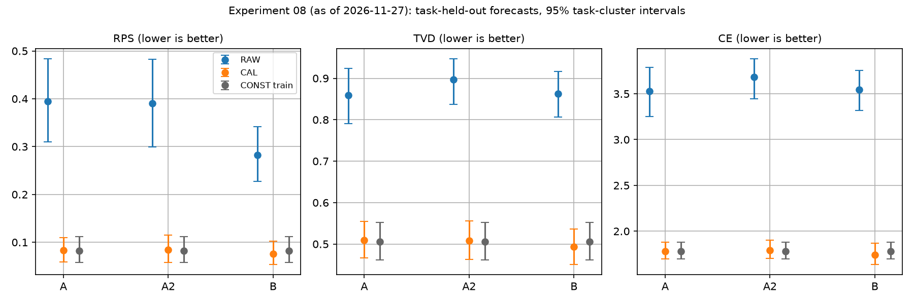
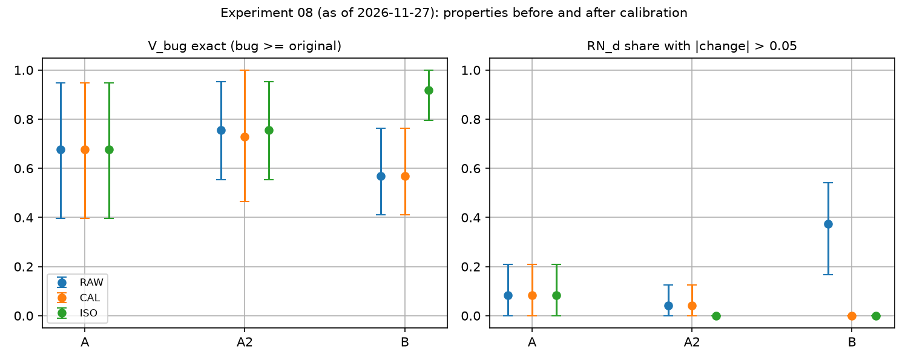

# RESULTS 08: task-held-out calibration of the experiment 05 judges (as of 2026-11-27)

Date: `2026-11-27`. **Preregistration:** [PREREG.md](PREREG.md), committed at [`6e28b12`](https://github.com/brando90/correlation-is-not-trust/commit/6e28b12) before any run.
**Cost:** `$0.00`. No judge LLM and no judge agent was called. CPU-only Python 3 (`numpy`, `scipy`, `matplotlib`) in `scripts/analysis.py`.
**Alignment:** **PASS.** In-sample experiment 05 headlines match the published point estimates within `0.0005` (`RPS`, `TVD`) and `0.005` (`CE`). Raw `V_bug`, exact-tie share, noise share, `RN_d` share, and `ID1` mean match within `0.001`. The material band uses experiment 05's comparison, absolute change `> 0.05 + 1e-9`, so a float that lands on `0.05` is not counted.

## Takeaway

- **H1-cal is untestable.** Leave-one-task-out ordinal calibration (`CAL`) brings all three logged judges next to the train-only constant on `RPS`, and none of the paired intervals lies entirely below 0. A (GPT-6 Astra, Codex CLI, Vals, `P4_CHECKLIST`) has `CAL` minus constant `+0.0007 [-0.0046, +0.0060]`. A2 (same model and harness, `P8_STRICT_B`) is reliably worse, `+0.0020 [+0.0008, +0.0035]` (sign-flip `p = 0.0005`), and the same direction holds for `TVD` and `CE`. B (Claude Opus 5.5, Claude Code CLI, Stanford, `P4_CHECKLIST`) has the only negative point estimate, `-0.0066 [-0.0229, +0.0136]` (`p = 0.5257`). The raw point-mass gap against the same train-only constant stays large (`+0.312`, `+0.307`, `+0.200`), so the experiment 05 loss to a constant was not an artifact of fitting that constant on the evaluated items.
- **Exact bug order is unchanged where the calibration is strictly increasing, and the `0.05` rename band is not.** A and B have a positive slope on all `25/25` held-out tasks (`min b = 0.548` and `2.416`) and `0` order reversals. Their exact `V_bug` is unchanged (`0.676` and `0.568`). B's declaration renames still move the score on `0.583` of `24` probes, but the share that moves by more than `0.05` falls from `0.375 [0.167, 0.542]` to `0.000 [0.000, 0.000]` (`9/24` flips). A2 has a negative slope on `5/25` tasks (`min b = -0.643`); exact `V_bug` moves from `0.757` to `0.730` (`7` pair flips).



## Proper scores against the train-only constant (75 items, 25 tasks)

Each forecast for a task is fit on the other `24` tasks only. `CAL` is the cumulative-logit ordinal model. `CONST` is the count-pooled training rating distribution with additive smoothing `0.5`. `RAW` is the experiment 05 point mass (`CE` uses the `0.9/0.1` smooth). Intervals are 95% task-cluster percentile bootstrap intervals, `2,000` draws, seed `20261127`, one generator per interval. Lower is better. A forecast beats `CONST` when the paired interval lies entirely below 0.

| Config | Harness, model, rubric | `CAL` `RPS` [95% CI] | `CAL` − `CONST` `RPS` [95% CI], `p` | `CAL` − `CONST` `TVD` | `CAL` − `CONST` `CE` | `RAW` − `CONST` `RPS` |
|---|---|---|---|---|---|---|
| A | Codex CLI, Vals; GPT-6 Astra; `P4_CHECKLIST` | 0.0832 [0.0592, 0.1095] | +0.0007 [−0.0046, +0.0060], `0.8056` | +0.0037 [−0.0043, +0.0115] | +0.0009 [−0.0263, +0.0287] | +0.3125 [0.2166, 0.4054] |
| A2 | Codex CLI, Vals; GPT-6 Astra; `P8_STRICT_B` | 0.0845 [0.0583, 0.1146] | **+0.0020 [+0.0008, +0.0035]**, `0.0005` | **+0.0025 [+0.0007, +0.0045]** | **+0.0111 [+0.0039, +0.0197]** | +0.3074 [0.2136, 0.3970] |
| B | Claude Code CLI, Stanford; Claude Opus 5.5; `P4_CHECKLIST` | 0.0759 [0.0538, 0.1022] | −0.0066 [−0.0229, +0.0136], `0.5257` | −0.0129 [−0.0387, +0.0138] | −0.0387 [−0.1229, +0.0714] | +0.2000 [0.1327, 0.2640] |
| `CONST` | train-task pooled ratings, `alpha = 0.5` | 0.0825 [0.0573, 0.1114] | 0 | 0 | 0 | 0 |

`CONST` `TVD` is `0.5060 [0.4617, 0.5524]` and `CONST` `CE` is `1.7797 [1.6947, 1.8820]`. The experiment 05 in-sample constant, fit on all 75 items with no smoothing, remains the alignment value `RPS 0.077`. The train-only smoothed constant is the confirmatory baseline.

Sensitivity `ISO` (pool-adjacent-violators on training score blocks) also fails to beat `CONST` on `RPS`: A `−0.0007 [−0.0065, +0.0057]`, A2 `+0.0034 [−0.0010, +0.0086]`, B `−0.0038 [−0.0223, +0.0179]`.

## Properties before and after calibration

The scalar after calibration is the expected rating of the task-held-out map, divided by 5. Exact comparisons use `1e-9`. The `0.05` band uses `> 0.05 + 1e-9`. `V_bug` has `37` probes. `RN_d` has `24`. Noise has `24` golds.



| Config | Scale | `V_bug` exact [95% CI] | Exact tie | `V_bug` within `0.05` | `RN_d` `> 0.05` [95% CI] | `RN_d` any exact change | Noise `> 0.05` | `RN_d` excess [95% CI] | Mean `\|RN_d\|` |
|---|---|---|---|---|---|---|---|---|---|
| A | `RAW` | 0.676 [0.395, 0.949] | 0.649 | 0.676 | 0.083 [0.000, 0.208] | 0.083 | 0.208 | −0.125 [−0.250, 0.000] | 0.083 |
| A | `CAL` | 0.676 [0.395, 0.949] | 0.649 | 0.676 | 0.083 [0.000, 0.208] | 0.083 | 0.208 | −0.125 [−0.250, 0.000] | 0.010 |
| A2 | `RAW` | 0.757 [0.553, 0.952] | 0.649 | 0.757 | 0.042 [0.000, 0.125] | 0.042 | 0.042 | 0.000 [0.000, 0.000] | 0.042 |
| A2 | `CAL` | 0.730 [0.465, 1.000] | 0.649 | 0.811 | 0.042 [0.000, 0.125] | 0.042 | 0.042 | 0.000 [0.000, 0.000] | 0.004 |
| B | `RAW` | 0.568 [0.410, 0.763] | 0.514 | 0.730 | 0.375 [0.167, 0.542] | 0.583 | 0.042 | +0.333 [0.125, 0.500] | 0.048 |
| B | `CAL` | 0.568 [0.410, 0.763] | 0.514 | 0.811 | 0.000 [0.000, 0.000] | 0.583 | 0.000 | 0.000 [0.000, 0.000] | 0.012 |

Flips of the `0.05` label, `RAW` versus `CAL`: `RN_d` `0` (A), `0` (A2), `9` (B); material bug `0`, `10`, `3`. Exact `V_bug` flips: `0`, `7`, `0`. Binder renames (`RN_b`, `n = 14`) stay at `0.071`, `0.071`, and `0.000` on both scales. All three configurations have `ID1` mean above `0.6` on the raw scale (`0.917`, `0.958`, `0.996`), so all three are valid. None qualifies, so the supported and falsified branches of H1-cal do not apply.

`ISO` on B, whose gold scores sit above the `CRIT` score range (maximum `CRIT` score `0.7`), maps those probes to one top training block. Exact `V_bug` becomes `0.919 [0.794, 1.000]` with tie share `0.919` and `13` exact-label flips. That is the pre-registered nearest-score rule under extrapolation, and it is not part of the qualifier.

## Limits

Three logged configurations, not a sample of judges. The ordinal map is trained on `CRIT` scores and applied to gold, rename, and bug scores that can lie outside that range. A2's negative slopes mean the calibrated expected score is not a monotone rewrite of the raw score on every task. The `0.05` band is a fixed width on the expected-rating scale, so a strictly increasing map can clear the band without changing exact order. Human ratings are the old VeriBench experiment 100 file (sha256 `ad9ed552…a96c`), read off-repo and not committed.

## Machine lines

Checked against `results/canonical_lines.txt` by `scripts/test_analysis.py`.

```text
VERDICT_H1_CAL untestable
CFG A valid=1 qualifies_rps=0 qualifies_all3=0 cal_rps=0.083 [0.059, 0.110] cal_rps_diff=0.001 [-0.005, 0.006] raw_rps_diff=0.312 [0.217, 0.405] const_rps=0.082 [0.057, 0.111] cal_tvd_diff=0.004 [-0.004, 0.011] cal_ce_diff=0.001 [-0.026, 0.029] min_b=0.5480 n_b_pos=25/25 order_viol=0 Vbug_raw=0.676 [0.395, 0.949] Vbug_cal=0.676 [0.395, 0.949] RNd_raw=0.083 [0.000, 0.208] RNd_cal=0.083 [0.000, 0.208] flips_rn_cal=0 flips_bugmat_cal=0
CFG A2 valid=1 qualifies_rps=0 qualifies_all3=0 cal_rps=0.085 [0.058, 0.115] cal_rps_diff=0.002 [0.001, 0.004] raw_rps_diff=0.307 [0.214, 0.397] const_rps=0.082 [0.057, 0.111] cal_tvd_diff=0.002 [0.001, 0.005] cal_ce_diff=0.011 [0.004, 0.020] min_b=-0.6430 n_b_pos=20/25 order_viol=0 Vbug_raw=0.757 [0.553, 0.952] Vbug_cal=0.730 [0.465, 1.000] RNd_raw=0.042 [0.000, 0.125] RNd_cal=0.042 [0.000, 0.125] flips_rn_cal=0 flips_bugmat_cal=10
CFG B valid=1 qualifies_rps=0 qualifies_all3=0 cal_rps=0.076 [0.054, 0.102] cal_rps_diff=-0.007 [-0.023, 0.014] raw_rps_diff=0.200 [0.133, 0.264] const_rps=0.082 [0.057, 0.111] cal_tvd_diff=-0.013 [-0.039, 0.014] cal_ce_diff=-0.039 [-0.123, 0.071] min_b=2.4156 n_b_pos=25/25 order_viol=0 Vbug_raw=0.568 [0.410, 0.763] Vbug_cal=0.568 [0.410, 0.763] RNd_raw=0.375 [0.167, 0.542] RNd_cal=0.000 [0.000, 0.000] flips_rn_cal=9 flips_bugmat_cal=3
ALIGN pass=1
```

## Reproduce

The items file stays off this repository. Point `--items` at VeriBench experiment 100 `inputs/items.jsonl` with sha256 `ad9ed552fc2ffac6328e6010bf6be82215dd74f1eddd791622d433126877a96c`.

```bash
python3 experiments/08_task_heldout_calibration_of_exp05_judges/scripts/analysis.py --items /path/to/items.jsonl
python3 -m unittest experiments/08_task_heldout_calibration_of_exp05_judges/scripts/test_analysis.py -v
```
