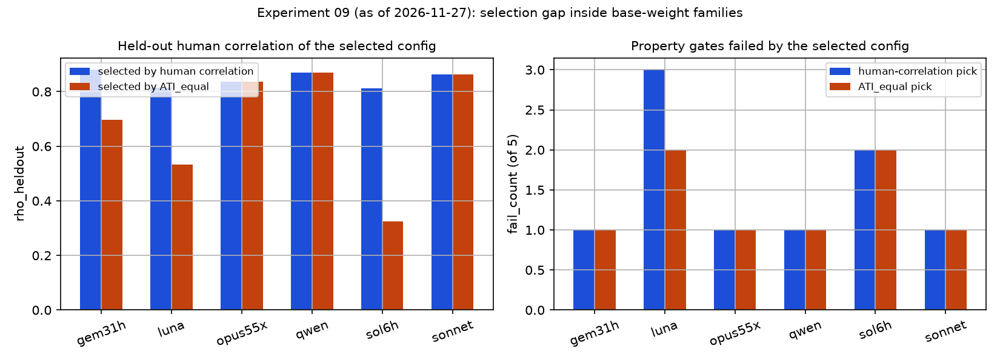

# RESULTS 09: selection gap between human correlation and formal properties (as of 2026-11-27)

Date: `2026-11-27`. **Preregistration:** [PREREG.md](PREREG.md), committed at [`6e28b12`](https://github.com/brando90/correlation-is-not-trust/commit/6e28b12) before any run; Amendment 1 at [`1c62824`](https://github.com/brando90/correlation-is-not-trust/commit/1c62824) before any run (`V_fmt` has no rate interval in the CSV, so `fail_count` uses the other five rates).
**Cost:** `$0.00`. No judge LLM and no judge agent was called. Input: `experiments/03_human_corr_vs_axiomatic_properties_cert_judge/results/judge_table.csv` (56 judge LLMs on `vb103_judge` and judge agents on `terminus2`).
**Alignment:** **PASS.** Spearman of `ATI_equal` with `rho_heldout` is `0.788325159465`, within `1e-9` of the experiment 07 cell.

## Takeaway

- **H-gap is mixed.** Inside `3/6` base-weight families, the configuration with the highest held-out human correlation is not the configuration with the highest `ATI_equal`. Mean Spearman regret of the property pick is `0.158`. Mean extra property-gate failures of the correlation pick is `0.167` (one family: `luna`, `3` versus `2`), short of the pre-registered gap of `0.5`. Both picks fail `V_weak` or `V_rep` in `6/6` families. Property selection disagrees with human-correlation selection and still returns a judge that fails the Idea 1 gate.
- **H-gap-fitted is falsified.** A nonnegative ridge fit to `rho_heldout` on the other families disagrees with the human-correlation pick in `3/6` families, and the mean failure gap is `0.000`. On `opus55x` the fitted pick trades `0.352` Spearman (`0.837` to `0.485`) for the same single gate failure.
- **H-pred is supported, and it is the weaker of the two associations already in view.** Out-of-fold scores from that rho-targeted ridge have Spearman `0.424 [0.195, 0.607]` with `rho_heldout` (`p = 0.0018`, `n = 56`). Experiment 07 already reported Spearman `0.788 [0.654, 0.869]` for the unfitted `ATI_equal` index. Equal weights track human correlation more strongly than weights refit with each family held out. A descriptive family-cluster interval for the fitted scores is `[0.265, 0.756]` (`n = 6` families; not used in the verdict).



## Per-family picks

`H` maximizes `rho_heldout`. `P` maximizes `ATI_equal` (mean of `1 - V` on `V_ms`, `V_weak`, `V_vac`, `V_overc`, `V_fmt`, `V_rep`). `F` maximizes the ridge score fit on the other five families. Ties within `1e-12` break toward the lexicographically smallest config name. A gate fails when the published value is `>= 0.20` and the published lower interval bound is `> 0.05`. `fail_count` omits `V_fmt` (Amendment 1). `idea1_fail` is `V_weak` or `V_rep`. This is a census of the six logged families.

| Family (`n`) | `H` (rho, failures) | `P` (rho, failures) | `F` (rho, failures) | Rho regret `P` | Fail gap `P` |
|---|---|---|---|---:|---:|
| `gem31h` (9) | `gem31h\|H2` (0.880, `V_weak`) | `gem31h\|H0` (0.697, `V_rep`) | `gem31h\|H0` (0.697, `V_rep`) | 0.183 | 0 |
| `luna` (11) | `luna6h\|H2` (0.815, `V_weak`, `V_overc`, `V_rep`) | `luna6h\|D0` (0.534, `V_weak`, `V_rep`) | `t2_luna\|H2` (0.810, `V_weak`, `V_overc`, `V_rep`) | 0.281 | 1 |
| `opus55x` (5) | `opus55x\|H2` (0.837, `V_weak`) | `opus55x\|H2` (0.837, `V_weak`) | `opus55x\|D0` (0.485, `V_rep`) | 0.000 | 0 |
| `qwen` (11) | `t2_qwen\|H2` (0.870, `V_rep`) | `t2_qwen\|H2` (0.870, `V_rep`) | `t2_qwen\|H2` (0.870, `V_rep`) | 0.000 | 0 |
| `sol6h` (9) | `sol6h\|H2` (0.811, `V_weak`, `V_overc`) | `sol6h\|D0` (0.325, `V_weak`, `V_rep`) | `sol6h\|H2` (0.811, `V_weak`, `V_overc`) | 0.486 | 0 |
| `sonnet` (11) | `t2_sonnet5\|H2` (0.864, `V_rep`) | `t2_sonnet5\|H2` (0.864, `V_rep`) | `t2_sonnet5\|H2` (0.864, `V_rep`) | 0.000 | 0 |

`terminus2` judge agents stay in the base-weight family of the judge LLM (`t2_qwen` with `qwen36`, `t2_sonnet5` with `sonnet5m`, `t2_luna` with `luna6h`). Harnesses: `vb103_judge` for the judge LLMs, `terminus2` for the `t2_*` judge agents. Models, as in experiment 03: `gem31h` Google Gemini 3.1 Pro, `qwen` Alibaba Qwen 3.6 27B, `sonnet` Anthropic Claude Sonnet 5, `opus55x` Anthropic Claude Opus 5.5, `luna` OpenAI GPT-6 Luna, `sol6h` OpenAI GPT-6 Sol.

The ridge puts its largest weight on `pass_weak` in every family (about `0.60` to `0.66`, except `luna` at `lambda = 10`, where shrinkage cuts it to `0.265`). Inner leave-one-family-out chose `lambda` in `{0.1, 1, 10}`. No family was flat (`0/6`).

Descriptive control check, not a verdict: `ATI_equal` for `ctl|editdist` is `0.833`, above the median of the 56 real configurations (`0.780`). `ctl|count_ratio` and `ctl|name_jaccard` are `0.500`. `ctl|random` is `0.257`. Experiment 07 already found that `ctl|editdist` can pass a continuous `ATI_equal` cutoff.

## Limits

The six families are the logged panel, shared across tasks, so the verdict uses the census counts and not a family bootstrap. `fail_count` follows the published intervals in `judge_table.csv`; those intervals were computed on the same tasks for every configuration. `V_bug` is excluded from `ATI_equal` and from `fail_count`, for the experiment 03 construct boundary. H-pred's configuration-level interval treats the 56 rows as exchangeable. The family-cluster interval is the dependence-aware description and is wide because there are six families.

## Machine lines

Checked against `results/canonical_lines.txt` by `scripts/test_analysis.py`.

```text
VERDICT_H_GAP mixed disagree_HP=3/6 fail_gap_P=0.167 rho_regret_P=0.158 idea1_H=6/6 idea1_P=6/6
VERDICT_H_GAP_FITTED falsified disagree_HF=3/6 n_flat=0 fail_gap_F=0.0
VERDICT_H_PRED supported spearman=0.424 [0.195, 0.607] p=0.001799640071985603
ALIGN spearman=0.788325159465
```

## Reproduce

```bash
python3 experiments/09_selection_gap_human_correlation_vs_formal_properties/scripts/analysis.py
python3 -m unittest experiments/09_selection_gap_human_correlation_vs_formal_properties/scripts/test_analysis.py -v
```
